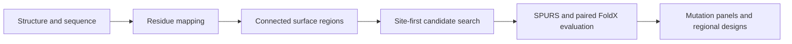

# ECD Epitope Scanner

A structure-guided computational pipeline for extracellular-domain (ECD) surface partitioning and mutation-panel design. The software supports the generation of spatially resolved mutation panels for experimental epitope mapping through a local web interface and a command-line workflow.

The released protocol, **`ordinary_site_first_v2`**, combines connected surface partitioning, site-first candidate enumeration, and stability-based candidate qualification. The implementation uses the `joint_v4_ml` engine. The repository provides source code, public PD-L1 example inputs, installation instructions, and computational validation records for use as accompanying research software.

## Computational workflow

1. **Structure and sequence mapping.** Map the selected chain to the canonical sequence and inclusive ECD coordinates while retaining residue identity and confidence provenance.
2. **Surface partitioning.** Estimate solvent accessibility and construct connected regions under geometric diameter constraints. Region number and construct budget are independently defined.
3. **Site-first candidate search.** Evaluate legal site combinations, then expand amino-acid substitutions through ordered candidate queues. SPURS calculations are scheduled in batches; paired FoldX calculations are allocated within a finite sampling budget.
4. **Evidence-based selection.** Qualify candidates using single- and combination-stability evidence. DiscoTope provides epitope-propensity annotations, and ProCaliper supplies an optional solvent-accessibility cross-check.
5. **Design and export.** Generate Stage 1 probe panels, Stage 2 single/pairwise follow-up designs, and regional recommendations, together with sequence files, scoring records, and provenance reports.



## Requirements

| Component | Recommended configuration |
| --- | --- |
| Main application | Python 3.12; locally validated on Windows |
| Preview workflow | CPU; 16 GB RAM |
| External-model workflow | Windows with WSL2 Ubuntu 22.04 and an NVIDIA GPU; 32 GB RAM |
| GPU memory | Approximately 8–12 GB, depending on protein length and batch size |
| Storage | Approximately 20–30 GB for environments, models, and one analysis |

These values are resource estimates. The recorded strict PD-L1 analysis produced approximately 6.7 GB of outputs, including a 544 MB result archive. Additional analyses require further storage.

## Installation

Clone the repository and open PowerShell in its root directory:

```powershell
git clone https://github.com/segayi1/ecd-epitope-scanner.git
cd ecd-epitope-scanner
py -3.12 -m venv .venv
.\.venv\Scripts\Activate.ps1
python -m pip install --upgrade pip
python -m pip install .
```

For the main application's tested Python 3.12 dependency versions, use:

```powershell
python -m pip install -c requirements-tested.txt .
```

If virtual-environment activation is unavailable, invoke `.\.venv\Scripts\python.exe` directly. A prebuilt wheel is available from [Releases](https://github.com/segayi1/ecd-epitope-scanner/releases); the source checkout supplies the example data and external-tool setup files.

### External software

The [external-tool installation guide](docs/external-tools.md) provides download and configuration commands for SPURS, ESM-2, DiscoTope3, optional ProCaliper, and FoldX. It specifies a fixed SPURS revision and the accompanying inference patch.

Users obtain model weights and scientific executables from their upstream sources. FoldX requires registration and license acceptance; DiscoTope3 is distributed under CC BY-NC 4.0. Additional terms are summarized in [THIRD_PARTY_NOTICES.md](THIRD_PARTY_NOTICES.md).

## Web interface

Launch the local service from the configured PowerShell session:

```powershell
$env:ECD_DATA_DIR = "$PWD\workspace_data"
python -m ecd_epitope_scanner serve
```

Open <http://127.0.0.1:8765>. Upload a structure and sequence, select the chain and ECD coordinates, and choose an evidence mode. AF3 output directories can be imported with their associated confidence files. Jobs, uploads, and results are stored in `ECD_DATA_DIR`.

A service health check is available at:

```powershell
Invoke-RestMethod http://127.0.0.1:8765/api/health
```

The service listens on loopback. Public database identifier lookup requires network access. Worker configuration is read at startup; restart the service after changing environment variables.

## Public PD-L1 example

The example contains the human PD-L1 AlphaFold DB model, canonical UniProt Q9NZQ7 sequence, chain A, and ECD residues 19–238. Input sources and attribution are recorded in [examples/pdl1_run/README.md](examples/pdl1_run/README.md).

### Preview execution

```powershell
python -m ecd_epitope_scanner analyze `
  --structure examples\pdl1_run\structure.pdb `
  --accession Q9NZQ7 `
  --chain A `
  --sequence examples\pdl1_run\canonical.fasta `
  --ecd 19:238 `
  --allow-partial `
  --ml-mode preview `
  --output .\workspace_data\pdl1_preview
```

Preview evaluates structure mapping, surface partitioning, candidate generation, and export. It uses the legacy execution path and can run without configured external predictors. Missing stability evidence yields empty formal design and recommendation sets.

### Strict V2 execution

After configuring the external workers, replace `--ml-mode preview` with `--ml-mode strict` and use a new output directory, such as `.\workspace_data\pdl1_strict`. Strict mode executes `ordinary_site_first_v2`.

| Evidence artifact | Content |
| --- | --- |
| `execution_protocol.json` | Executed protocol and scoring budgets |
| `ordinary_candidate_ledger.json` | Per-region/principle queue states and remaining gaps |
| `tool_inventory.json` | Software and model identity |
| `recommendation_diagnostics_v41.json` | Worker outcomes and candidate exclusions |
| `card_evidence_completeness.json` | Recommendation-card completeness, when produced |
| `run_manifest.json` | Export inventory and artifact digests |

## Outputs

Each analysis exports mapped structures, surface and coverage records, candidate/design tables, `designs.csv`, sequence files, `methods_report.md`, `offline_report.html`, and a result ZIP. Regional recommendations are retained alongside the global probe panel. Mutation coordinates and exported sequences should be matched to the intended experimental construct before synthesis.

## Validation

The recorded public PD-L1 analysis yielded:

| Measure | Result |
| --- | --- |
| Installed-package tests, Windows / Python 3.12 | 84 passed |
| Strict surface regions | 11 |
| Exported designs | 57 |
| Design composition | 7 Stage 1 probes; 16 Stage 2 singles; 8 Stage 2 pairs; 26 regional designs |
| Principle queues | 33 complete |
| FoldX paired sampling slots | 113 valid; 0 failed; budget 300 |
| Evidence cards | 66; completeness PASS |
| Export verification | 736 manifest-listed files matched their recorded digests |

The browser preview completed and its saved result was reloaded successfully. Detailed records are provided in [VALIDATION.md](VALIDATION.md) and [acceptance/README.md](acceptance/README.md). Current automated checks are listed under [Actions](https://github.com/segayi1/ecd-epitope-scanner/actions).

### Run the test suite

```powershell
python -m pip install pytest
$releaseRoot = (Get-Location).Path
Push-Location $env:TEMP
python -m pytest --import-mode=importlib -q "$releaseRoot\tests"
Pop-Location
```

The suite covers residue mapping, confidence handling, region geometry, queue scheduling, sampling budgets, evidence pairing, export consistency, privacy, and packaged web resources. Running outside the checkout exercises installed-package imports. External-model scoring is represented by controlled fixtures in automated tests and by real calculations in the separate strict validation record.

## Reproducibility and interpretation

Record the software release or commit, external-tool versions, model identities, input structure, residue mapping, and confidence source for each analysis. Exact scores and candidate selections can vary with sampling and numerical environment. FoldX sampling slots represent computational side-chain sampling. The public PDB example was processed as an ordinary structure upload; ProCaliper was not invoked in that run. Fresh-machine external installation and AF3 multi-model inference are outside the recorded acceptance scope.

The pipeline generates computationally qualified designs for experimental evaluation. Establishing effects on binding, expression, or folding requires the corresponding experimental measurements.

The repository includes public example inputs and sanitized validation summaries. Before sharing new outputs, review uploaded content and use the supplied archive scanner with relevant private markers:

```powershell
$env:ECD_PRIVACY_MARKERS = 'your-private-marker;another-private-marker'
python scripts\check_export_privacy.py .\workspace_data\pdl1_preview\ecd_epitope_design.zip
```

## Citation

Cite the software release or exact commit used in an analysis, together with the external methods and structural data sources. Machine-readable software metadata is provided in [CITATION.cff](CITATION.cff). The associated manuscript citation can be added when its bibliographic record is available.

```bibtex
@software{ecd_epitope_scanner_1_0_0,
  author  = {segayi1},
  title   = {ECD Epitope Scanner},
  version = {1.0.0},
  year    = {2026},
  url     = {https://github.com/segayi1/ecd-epitope-scanner/releases/tag/v1.0.0}
}
```

## License

Repository code is available under the [MIT License](LICENSE). Bundled web-viewer licenses and external-tool terms are listed in [THIRD_PARTY_NOTICES.md](THIRD_PARTY_NOTICES.md).
