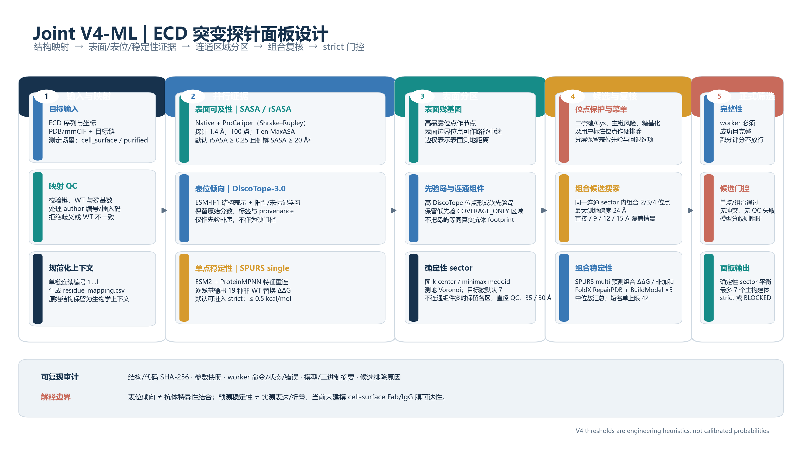

# Joint V4-ML：结构引导的 ECD 突变探针面板设计方法

**汇报版 Method｜ECD Epitope Scanner v4**  
**目标：**依据 ECD 结构和可审计的模型证据，提出一组用于实验粗定位的表面突变构建体，并筛除明显缺乏结构映射或预测稳定性证据的候选。

图 1｜输入结构经残基映射后并行计算表面可及性、表位倾向与单点稳定性；通过表面图分区生成候选，再以组合稳定性模型和候选级门控筛选最多 7 个主面板构建体。图中参数为当前配置默认值。

## 1. 方法概述

Joint V4-ML 是一个结构约束的**实验候选生成与筛选流程**，不是抗体–抗原对接，也不直接输出某一抗体的真实表位或结合概率。它把三个不同问题串联处理：

1. **哪些残基位于结构表面？** 通过溶剂可及表面积（SASA/rSASA）和显式表面几何图界定可设计区域。
2. **哪些表面位置可优先进入定位面板？** 使用 DiscoTope-3.0 的残基级表位倾向作为软排序先验，同时保留低先验回退候选。
3. **哪些突变组合预测上较少扰动整体稳定性？** 用 SPURS 预测单点和组合稳定性变化，并以 FoldX 的经验能量模型进行组合复核。

最终得到的是“在当前结构、模型、阈值和实验场景下可优先测试的突变组合”。所有阈值均为工程筛选参数，未经该 ECD 目标上的实验校准。流程结构见图 1，完整实现参数和产物定义另见 [Joint V4-ML 方法学](method_joint_v4.md)。

## 2. 输入、编号与结构上下文

输入包括 ECD 氨基酸序列及其在全长蛋白中的起止坐标、PDB/mmCIF 结构、目标链、结构来源类型、可选全长 CDS、实验场景（`cell_surface` 或 `purified`）和 V4 配置。保留两种结构上下文：原始结构作为生物学上下文，规范化单链结构作为外部预测工具输入。

结构中的 author 编号可能不连续，也可能带插入码。V4 在调用模型之前逐残基验证结构残基与目标 WT 序列，并建立 `residue_mapping.csv`，连接规范化位置、UniProt 位置、链号、author 编号、插入码和 WT 氨基酸。规范化预测链从 1 连续编号；结构中没有坐标的残基不被虚构。链选择不唯一、WT 不匹配或结构残基缺失会触发明确错误，而不是按行号猜测映射。

## 3. 逐步方法

### 步骤 1：结构预处理与残基映射

使用 Biopython 解析 PDB/mmCIF，并按已验证的目标链和映射表导出单链 `prediction_context.pdb`。将规范化结构和权威 sidecar 提供给外部 worker，使所有外部残基编号在预测阶段一致。外部结果先检查位置范围、WT、记录类型和完整性，再映射回 UniProt 坐标。

### 步骤 2：并行计算表面和残基级先验

**2a. SASA 与相对 SASA。** 本地结构流水线和 ProCaliper worker 分别计算残基 SASA。当前 ProCaliper worker 调用其 `calculate_sasa` 接口；运行 provenance 标记所用方法为 Bio.PDB Shrake–Rupley，探针半径 1.4 Å、100 个球面采样点。绝对 SASA 按 Tien 等人的氨基酸最大可及面积表归一化：

\[
\mathrm{rSASA}_i = \frac{\mathrm{SASA}_i}{\mathrm{MaxASA}(a_i)}.
\]

当前表面筛选默认要求 rSASA ≥ 0.25 且侧链 SASA ≥ 20 Ų；边界表面节点可参与几何连通路径。两次 SASA 结果按差值规则标为 `AGREE`、`SASA_DISAGREEMENT` 或 `NOT_COMPARED`。由于本地和 ProCaliper 都采用 Shrake–Rupley 采样，这是一项实现/参数一致性检查，并非两种独立物理理论的交叉验证。strict 模式下，候选位点若落在两者表面分类不一致处，不进入正式面板。

**2b. DiscoTope-3.0 表位倾向。** 对规范化结构链调用 DiscoTope-3.0，获得逐残基原始倾向分数及模型输出标签。算法利用 ESM-IF1 逆折叠结构表示构造残基特征，并在阳性-未标记学习框架下训练 XGBoost 集成分类器，以适配实验表位标签不完整的场景。V4 分别保留原始分数、可选校准分数、原模型二元标签及来源 provenance；当校准值缺失时，使用原始分数进行相对排序。分位数只在当前表面图节点中计算，并从图邻居计算局部峰值。默认 seed 分位数为 0.80，局部峰值筛选参数为 0.65。该输出是候选优先级的**软先验**，不等同于本目标抗体的表位概率。

**2c. SPURS 单点稳定性。** SPURS 输入 WT 序列和结构，输出每个位置 19 种非 WT 氨基酸替换的预测 ΔΔG。其模型将 ESM2 的序列进化表示与 ProteinMPNN 的结构表示通过 neural rewiring 融合；额外预测器从共享残基表示解码单点替换影响。当前实现以结构残基为单位请求完整单点矩阵。默认分带为：`PREFERRED` ≤ 0.0 kcal/mol；`ACCEPTABLE` 为 (0.0, 0.5]；`REVIEW` 为 (0.5, 1.0]；更高则 `REJECT`。这些是本项目门控阈值，不是 SPURS 原论文的普适实验放行界限。

在模型候选生成前，应用已有保护规则，包括半胱氨酸/二硫键、脯氨酸或甘氨酸相关主链风险、糖基化 sequon/注释位点及用户明确标记的功能保护位点。位点级筛选只让通过硬规则、映射检查且达到 strict 单点分带的突变进入正式组合搜索；preview 可保留未评分项，但不会产生正式推荐。

### 步骤 3：构建表面图并划分 sector

V4 使用上游显式溶剂表面采样点与残基归属构建加权残基表面图。图节点表示高暴露、可设计残基；边界残基在有几何表面支持时允许作为测地路径中继。边权为表面图估计的残基间距离。只对连续序列残基、具有表面点且 Cα 距离不超过 4.5 Å 的位置补充主链连接；限制中继路径长度以降低穿越蛋白核心的捷径风险。

DiscoTope 高分位置和局部峰值聚成表位先验岛屿，但不直接作为 sector 边界。每个表面连通分量先分配种子，后续中心通过确定性最远点采样和有限轮 minimax-medoid 更新选择，再按图最短路进行 Voronoi 分配。目标 sector 数默认最多 7 个；若不连通表面组件数超过预算，为避免强行合并不相连表面，实际 sector 数可以超过 7。小于 4 个残基或面积小于 50 Ų 的区域尝试并入共享边界最多且距离最近的邻区。sector 默认几何 QC 上限为测地直径 35 Å、欧氏直径 30 Å；超限或图连通失败会保留质量标记，并在 strict 门控中阻断相应候选。

这是本项目的确定性几何分区策略，不是另一个已训练的表位预测模型，也没有声称由某篇外部论文直接验证。所有分区节点保留，低 DiscoTope 分数的区域仍以 `COVERAGE_ONLY` 表示，避免通过删去低先验位置缩小覆盖分母。

### 步骤 4：生成单点菜单及 2–4 位点组合

对通过位点级筛选的替换建立候选菜单，默认每位点最多保留 3 个替换。每个 sector 的搜索池最多 12 个位点、beam width 300、shortlist 30；搜索组合阶数为 2、3、4。候选必须来自同一连通 sector，位点在表面图上连通，组合测地跨度默认不超过 24 Å。site pool 和 shortlist 按 DiscoTope 支持与回退类别分层，防止先验占满预算。

每一候选计算直接位点情景和测地半径 9、12、15 Å 的覆盖集合与评分。若组合至少包含一个达到 seed 分位数或属于局部峰值的位点，则标记为 `EPITOPE_PRIORITIZED`；其余仍通过相同的结构和稳定性检查，但标记为 `STABILITY_FALLBACK`。这里的“覆盖”是结构邻近残基的计算性近似，不是实验抗体 footprint。

### 步骤 5：组合稳定性复核

**SPURS multi** 对每个请求组合预测组合 ΔΔG。对于每个候选，V4 还计算相对于其单点分数和的偏离量：

\[
\epsilon_{\mathrm{SPURS}} = \Delta\Delta G_{\mathrm{multi}} - \sum_j \Delta\Delta G_{j,\mathrm{single}}.
\]

该量描述模型输出的非加和偏离，受模型定义与误差影响，不应直接解释为实验测得的纯热力学耦合能。

**FoldX** 对确定性短名单执行 `RepairPDB` 后运行 `BuildModel`；每一候选默认 5 次建模，以中位数汇总。短名单默认上限 42 个，按 sector 均衡抽取；主推荐面板预算默认 7 个，两者含义不同。FoldX 候选 ddG 门槛默认 2.0 kcal/mol，SPURS 与 FoldX 预测差异超过 1.5 kcal/mol 标记 `MODEL_DISAGREEMENT`。组合一致通过时为 `CONSENSUS_PASS`；仅 SPURS multi 可用时通常要求用户显式开启 `allow_spurs_only_final`，且被标记为 `SPURS_ONLY_REVIEW_REQUIRED`。

高阶（3/4 位点）组合额外要求相对同一 sector 低阶组合达到至少 0.05 的内部覆盖增益，并且必须有 FoldX 结果。上述数值均属于项目启发式规则。SPURS 与 FoldX 都预测稳定性，二者的共识有助于发现模型分歧，但不能视为独立实验重复或保证真实构象不变。

### 步骤 6：strict 门控和面板选择

每个 worker 返回 `success`、`partial` 或 `failed` 以及 records、warnings、errors、provenance。成功还必须满足工具专属结构校验：ProCaliper/DiscoTope 覆盖规范化整链；SPURS single 给出全链完整的 19 替换矩阵；SPURS multi/FoldX 返回请求的全部组合，且无位置、WT、重复或非有限数值错误。失败 worker 即使携带了部分 score，也不作为 strict 稳定性证据。

strict 正式候选须满足：单点证据可用且通过；无硬排除、表面分类冲突、sector 几何失败；组合证据 `CONSENSUS_PASS`（或显式设置的 SPURS-only 例外）；高阶条件通过。任何必需 worker 缺失/不完整、没有合格候选或模型分歧都会使顶层状态成为 `BLOCKED_EXTERNAL_EVIDENCE`。preview 固定为非正式状态，不可用于实验放行。

面板通过确定性 sector 系列选择，优先低阶、较低组合风险、较低结构风险，再参考覆盖和表位先验；类别内部通过位点组合去重。总数不超过 7，每 sector 的推荐不超过 6 个，3/4 位点主候选不超过 2 个。V4 计算选中候选的覆盖并集，以全部已分区高暴露表面节点作分母，并另计面积加权覆盖。该选择器是规则驱动的平衡排序，不是经湿实验目标函数训练的全局最优面板算法。

### 步骤 7：审计与输出

每次运行导出 `v4_manifest.json`、`tool_inventory.json`、`residue_mapping.csv`、`surface_evidence.csv`、`sasa_comparison.csv`、`spurs_single_matrix.csv.gz`、`discotope_residues.csv`、`probe_sectors_v4.json`、`candidate_combinations.csv.gz`、`combination_stability.csv`、`selected_panel_v4.json` 和 `v4_scientific_report.md`。Manifest 经 JSON Schema 校验并记录参数、代码摘要、规范化结构 SHA-256、工具命令、worker 状态/错误/耗时和实际模型/二进制摘要。SPURS、DiscoTope 和 FoldX 当前不复用结果缓存；FoldX RepairPDB 修复缓存按输入结构与二进制摘要分区。

## 4. 外部算法与原始文献

| 算法/组件 | 在 v4 中的角色与原理 | 实现解释与原始文献 |
|---|---|---|
| Shrake–Rupley SASA | 在每个原子范德华半径外扩探针半径，布置球面采样点；按未被邻近原子遮挡的点估算可及表面积。 | 本项目 ProCaliper worker 采用 Bio.PDB 的 Shrake–Rupley 路径，100 点/原子、探针 1.4 Å。基础论文：Shrake & Rupley, 1973, *J Mol Biol*, [DOI](https://doi.org/10.1016/0022-2836(73)90011-9)。[Bio.PDB 实现文档](https://biopython.org/docs/latest/api/Bio.PDB.SASA.html)。 |
| Tien 最大 ASA 归一化 | 以每种氨基酸的参考最大 ASA 将绝对 SASA 转成 rSASA，降低氨基酸侧链大小差异造成的偏差。 | Tien et al., 2013, *PLOS ONE*, [DOI / 全文](https://doi.org/10.1371/journal.pone.0080635)。这是归一化标尺，不是表位分类器。 |
| ProCaliper 0.2.1 | 在 v4 中提供另一条可审计的 SASA 计算/worker 接口，用于检查覆盖、输入映射和计算结果一致性。 | 代码调用 `procaliper.protein_structure.sasa.calculate_sasa`，其 provenance 标为 Bio.PDB Shrake–Rupley。就本仓库已验证实现而言，它没有构成与 native SASA 独立的预测算法；不能把二者一致性描述为独立方法验证。未在仓库中发现单独的 ProCaliper 原始方法论文。 |
| DiscoTope-3.0 | 对抗原结构输出残基级 B 细胞表位倾向。用逆折叠结构表示（ESM-IF1）作为特征，并结合阳性-未标记学习；允许对实验结构和预测结构评分。 | Høie et al., 2024, *Frontiers in Immunology*, [DOI / 论文](https://doi.org/10.3389/fimmu.2024.1322712)。ESM-IF1 原始方法：Hsu et al., ICML 2022, [PMLR 论文](https://proceedings.mlr.press/v162/hsu22a.html)。 |
| SPURS | 预测突变相关蛋白稳定性变化 ΔΔG；将 ESM2 序列模型和 ProteinMPNN 逆折叠结构模型表示经 rewiring 融合，并有组合突变/非加和预测模块。 | Li & Luo, *Nature Communications* 17:891 (2026; online 2025), [正式论文](https://doi.org/10.1038/s41467-025-67609-4)。底层模型：ESM-2, Lin et al., 2023, *Science*, [DOI](https://doi.org/10.1126/science.ade2574)；ProteinMPNN, Dauparas et al., 2022, *Science*, [DOI](https://doi.org/10.1126/science.add2187)。 |
| FoldX / FOLDEF | 基于全原子经验力场估算蛋白突变前后能量差；`RepairPDB` 预处理输入结构，`BuildModel` 建模指定突变。v4 以多次运行中位数降低单次建模波动。 | 初始 FOLDEF：Guerois et al., 2002, *J Mol Biol*, [DOI](https://doi.org/10.1016/S0022-2836(02)00442-4)；FoldX 软件/力场说明：Schymkowitz et al., 2005, *Nucleic Acids Research*, [DOI](https://doi.org/10.1093/nar/gki387)。 |

**本项目自定义算法不是外部模型：**表面图的残基连边、最短路、图 k-center/minimax-medoid、图 Voronoi、候选 beam search、保护规则、模型差异阈值和最终 sector 平衡选择由本仓库实现。它们属于可审计的启发式计算流程；参数并非通过目标数据学习得到，也没有独立性能论文可引用。

## 5. 解释边界与汇报建议

- **不具抗体特异性：**当前输入不包含目标抗体序列、抗原–抗体复合物或对接姿势。DiscoTope 先验不能回答指定抗体是否结合某 patch。
- **几何可及性不等于细胞可达：**`cell_surface` 模式目前不模拟膜平面上的 Fab/IgG 体积排斥、糖萼或全长蛋白邻近结构；孤立 ECD 表面的残基不能直接称为活细胞可达表位。
- **计算稳定性不是表达/折叠实测：**SPURS 与 FoldX 的共识只代表指定结构和模型中的预测一致，不能证明突变体表达、膜定位、构象或功能正常。
- **实验标签稀疏与未知表位：**已知抗体复合物只标出被观察到的表位，不代表其他未观察表面绝非表位。Cia 等对 250 余个抗体-抗原结构评估九种上一代构象表位工具，报告总体性能偏低且部分接近随机表面 patch；该研究早于 DiscoTope-3.0，不能直接作为 V4 或 DiscoTope-3.0 的性能估计，但说明独立基准和盲测不可省略。评估必须按抗原家族隔离训练/测试并报告覆盖与失败率。
- **尚无 v4 性能优势的实验结论：**当前测试覆盖软件契约和确定性逻辑。结构接触命中只能用于开发期代理评估；优越性需固定预算外部对照和前瞻实验（表达/膜展示、构象对照、目标抗体结合）支持。

组会汇报建议把结论表述为：**v4 把残基级表位倾向、表面几何和突变稳定性约束整合成一个可审计的实验候选面板生成流程；它的贡献在流程整合、候选可解释性和失败门控，当前尚未证明比成熟方法更准确地定位真实抗体表位。**

## 6. 参考文献速查

1. Shrake A, Rupley JA. Environment and exposure to solvent of protein atoms. *J Mol Biol*. 1973. [https://doi.org/10.1016/0022-2836(73)90011-9](https://doi.org/10.1016/0022-2836(73)90011-9)
2. Tien MZ, et al. Maximum Allowed Solvent Accessibilites of Residues in Proteins. *PLOS ONE*. 2013. [https://doi.org/10.1371/journal.pone.0080635](https://doi.org/10.1371/journal.pone.0080635)
3. Høie MH, et al. DiscoTope-3.0: improved B-cell epitope prediction using inverse folding latent representations. *Front Immunol*. 2024. [https://doi.org/10.3389/fimmu.2024.1322712](https://doi.org/10.3389/fimmu.2024.1322712)
4. Hsu C, et al. Learning inverse folding from millions of predicted structures. *ICML/PMLR*. 2022. [https://proceedings.mlr.press/v162/hsu22a.html](https://proceedings.mlr.press/v162/hsu22a.html)
5. Li Z, Luo Y. Generalizable and scalable protein stability prediction with rewired protein generative models. *Nat Commun*. 17:891 (2026; online 2025). [https://doi.org/10.1038/s41467-025-67609-4](https://doi.org/10.1038/s41467-025-67609-4)
6. Lin Z, et al. Evolutionary-scale prediction of atomic-level protein structure with a language model. *Science*. 2023. [https://doi.org/10.1126/science.ade2574](https://doi.org/10.1126/science.ade2574)
7. Dauparas J, et al. Robust deep learning–based protein sequence design using ProteinMPNN. *Science*. 2022. [https://doi.org/10.1126/science.add2187](https://doi.org/10.1126/science.add2187)
8. Guerois R, Nielsen JE, Serrano L. Predicting changes in the stability of proteins and protein complexes: a study of more than 1000 mutations. *J Mol Biol*. 2002. [https://doi.org/10.1016/S0022-2836(02)00442-4](https://doi.org/10.1016/S0022-2836(02)00442-4)
9. Schymkowitz J, et al. The FoldX web server: an online force field. *Nucleic Acids Res*. 2005. [https://doi.org/10.1093/nar/gki387](https://doi.org/10.1093/nar/gki387)
10. Cia G, Pucci F, Rooman M. Critical review of conformational B-cell epitope prediction methods. 2023. [https://doi.org/10.1093/bib/bbac567](https://doi.org/10.1093/bib/bbac567)
