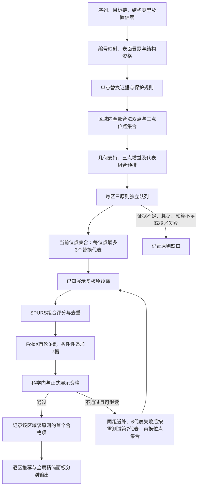

# 普通 V4 位点优先突变体筛选方法

版本日期：2026-11-03。算法源码基准：`f2b310e` 及本轮效率与召回修订（`codex/joint-v4-ml` 工作树）。

本文描述普通 V4 流程中的双点、三点突变体筛选。`ordinary_site_first_v2` 是当前生产默认协议，并保留对历史 `ordinary_three_principle_adaptive_v1` 结果的兼容。方法适用于基于结构的表面突变探针设计；输出包括逐区域、逐设计原则的合格突变体、全局精简实验面板，以及未完成推荐的原因。

## 1. 研究目标与方法概述

筛选目标是在结构允许的表面区域内，选择具有明确侧链化学变化、空间覆盖互补性和计算稳定性支持的少量组合突变体，用于后续实验定位功能相关表面。算法将位点选择、氨基酸替换选择和组合稳定性验证分开：先确定合法位点集合及其几何支持，再在当前位点集合内展开有限的替换代表，最后按三条独立设计原则逐项验证和递补。

每个区域分别建立表位支持、机制扰动和区域覆盖队列。一个候选只有依次满足单点准入、组合合法性、SPURS 组合阈值、FoldX 重复确认、正式科学门和展示资格，才能成为该原则的推荐。各队列在获得首个合格候选后结束；相同突变组合的模型结果可以复用，区域及原则的完成状态分别保留。



## 2. 协议版本与适用范围

当前源码与新任务的生产默认值为 `ordinary_site_first_v2`。网页及任务 API 的 `execution_protocol` 可显式选择实验协议；Python 也可通过 `PipelineRequest.metadata.joint_v4_ml.execution_protocol.name` 指定。普通自适应调度只在 `strict` 且未进入专用表面物理扰动预览流程时启用。

实验协议 `ordinary_site_first_perturbation_v1` 单独启用表面扰动代理排序和三点增强准入；它不改变默认 v2 的选择规则。每个展开的三点代表须有三个序列合法、证据完整的精确双点父本，并满足区域覆盖增益门或相对最强父本的正扰动边际，随后仍须通过组合 SPURS、FoldX 和正式展示门。逐表面残基的表位先验用于软权重，缺失时中性；扰动场是基于测地支持与化学变化的未校准代理，不代表实测结合损失。新协议的真实模型和完整协议对照验收状态以项目记忆中的最新记录为准。

| 项目 | 普通自适应 v1 | 位点优先 v2 |
| --- | --- | --- |
| 候选空间组织 | 枚举合法位点集合上的全部合格替换组合，建立任务内 SQLite 索引 | 先枚举位点集合，再按需展开当前集合的替换代表 |
| 几何计算 | 相同位点集合的替换共享几何 | 每个合法位点集合先计算一次几何 |
| 替换搜索 | 合格替换笛卡尔积 | 每个位点最多 3 个初始代表，必要时扩展至 6 个，失败后按需测试第 7 个 |
| 位点集合机制预排 | 完整候选排序 | 每集合最多 3 个真实替换见证组合预排 |
| 原则目标 | 每区三原则各获首个合格项 | 同左，另执行正式展示资格递补 |
| SPURS 组合预算 | 最多 1000 个唯一请求，最多 64 个/批 | 同左；队首缺少分数时按队列轮转补批 |
| FoldX 预算 | 最多 300 个尝试槽；3→10 确认 | 同左；跨队首批处理最多 8 个唯一组合 |
| 已知复核项预筛 | 不采用 v2 展示预筛合同 | 默认 `known_review_v1` |
| 十槽通过的展示确认 | 不采用 v2 确认合同 | 默认 `ten_slot_median_v1` |

选择 v2 后，引擎在上述两项策略未提供时补入默认值。旧任务是否采用这些规则，必须读取该任务保存的协议，不能仅凭文件名或当前源码判断。历史 `legacy` 的五槽合同与本文的 3→10 合同分开解释。物理扰动预览流程也使用独立路线。

复现本文协议时，可在任务请求中明确保存以下设置；结构、模型和其他参数仍由完整任务请求提供：

```json
{
  "metadata": {
    "joint_v4_ml": {
      "execution_protocol": {
        "name": "ordinary_site_first_v2",
        "display_prefilter": "known_review_v1",
        "repeat_confirmation_policy": "ten_slot_median_v1",
        "spurs_unique_request_limit": 1000,
        "foldx_slot_limit": 600
      }
    }
  }
}
```

## 3. 输入、编号与结构证据

输入包括分析序列及其坐标范围、选定的 PDB/mmCIF 目标链、实验或预测结构类型，以及可用的原始置信度和注释。AF3 输入保留选定模型与对应置信度文件的来源关系。结构解析同时保存序列位置、结构 author 编号及插入码、规范化预测链编号；模型请求使用规范化编号，结果再映回序列坐标。

突变定义使用“位置、野生型残基、目标残基”的明确对应关系。序列与结构的 WT 不一致、重复位置或超出序列范围的替换不能进入正式组合。相同氨基酸替换在不同区域上下文中具有各自的候选标识；模型评分按排序后的完整突变签名去重。

结构证据分三层处理：表面暴露决定是否属于可分析表面；坐标可靠性决定是否参与几何；保护注释、置信度复核和单点稳定性决定能否作为突变位点。表面可见、几何可用和可正式突变不是同一个资格字段。

## 4. 表面与显示区域

### 4.1 表面准入

默认表面准入使用原生结构分析得到的总相对溶剂可及面积：

\[
\mathrm{rSASA}_i=\frac{\mathrm{SASA}_i}{\mathrm{MaxASA}(a_i)},\qquad
\mathrm{rSASA}_i\geq 0.25.
\]

侧链 SASA 单独保存；侧链暴露比例用于机制分析。当前普通流程不把“侧链 SASA ≥20 Ų”作为与 rSASA 并列的表面硬门。ProCaliper 结果用于方法及结构上下文核对；其不一致或设置未核实保留为诊断。原生上下文与规范化上下文的暴露分类发生改变时，相关候选不能直接进入正式推荐。

预测结构默认以 pLDDT 70 为残基置信度复核界限；低于阈值或缺少该证据时记录复核原因。进一步的结构可靠性分析独立判定坐标是否适合三维足迹分析。实验结构不把温度因子当作预测置信度使用。

### 4.2 区域几何与规模

显示区域由表面图构建，要求连通，并接受最大测地直径 30 Å、最大欧氏直径 22 Å 的检查。默认最小区域面积为 50 Ų、最少 4 个残基。区域规模根据本次实际分析的残基记录数确定：

| 分析残基数 L | 目标区域大小 | 偏好范围 |
| --- | --- | --- |
| L <120 | 7 个残基 | 6–8 |
| 120≤L≤150 | 8 个残基 | 6–10 |
| L >150 | 12 个残基 | 10–15 |

这些目标大小及区域数量是软目标；几何连通性和直径要求单独检查。用户提供的区域参数可以覆盖偏好值。显示区域提供候选归属和逐区覆盖分母；可重叠的科学足迹假设用于后续响应及可辨识性分析。区域数与最终构建体预算分别管理。

## 5. 单点替换池与序列保护

### 5.1 单点候选构建

对每个有映射的残基，枚举标准氨基酸集合中除 WT 外的 19 种替换，并关联实际 SPURS 单点分数。满足以下要求的选项才进入组合位点池：属于结构图、已标记为 eligible、无硬排除、无结构复核标记，并具有有限单点分数。

单点分数采用单向上限，默认分层如下。所有数值均沿用适配器输出的 ΔΔG 方向和 kcal/mol 单位。

| SPURS 单点值 s | 层级 | 进入普通组合池 |
| --- | --- | --- |
| s≤0.5 | PREFERRED | 可以，仍需满足其余条件 |
| 0.5<s≤1.0 | ACCEPTABLE | 可以，仍需满足其余条件 |
| 1.0<s≤2.0 | REVIEW | 不进入正式组合池 |
| s>2.0 | REJECT | 排除 |
| 缺失或非有限值 | NOT_SCORED / 无效证据 | 不进入正式组合池 |

门槛检查的是 s 本身，不是绝对值 |s|。单点分数较低只能说明其符合本筛选阈值，组合仍需独立评分。

### 5.2 保护规则

普通流程保护野生型 C、G、P，并禁止自动引入 C、G、P。二硫键、已注释糖基化位点及 PTM、既有 N-糖基化 sequon 和其他残基级硬排除均随单点证据保留。缺少合格选项的残基不进入组合位点池。

每个实际组合还在完整参考序列上联合检查：应用全部替换前后的 N-X-S/T sequon 集合必须相同。这里 X 不能为 P。联合检查能够识别只有多点同时替换才会创建或破坏的 sequon。该检查同时验证位置、WT、替换合法性及重复位置；不能仅依据单点检查推断组合合法。

## 6. 位点集合枚举与几何支持

对每个区域 R，令 P_R 为其中至少有一个合格单点替换且位于结构图上的残基集合。枚举 P_R 中全部二元和三元位点子集。每一对位点须在区域允许的图上可达，且最短测地距离不超过默认 24 Å。三点集合要求三对距离全部通过。

几何只依赖位点集合 S，在选择具体氨基酸前计算。设 a_j 为表面图中残基 j 的合格映射面积，d_G 为表面图最短路径距离，定义半径 r 下的邻域并集：

\[
U_r(S)=\bigcup_{i\in S}\{j:d_G(i,j)\leq r\},\quad r\in\{9,12,15\}\;\mathrm{Å}.
\]

区域覆盖率及其三尺度均值为：

\[
C_r(S\mid R)=\frac{\sum_{j\in U_r(S)\cap R}a_j}{\sum_{j\in R}a_j},\qquad
\overline C(S\mid R)=\frac{C_9+C_{12}+C_{15}}{3}.
\]

同一位点集合的所有氨基酸替换共享这些值。当前 v2 的几何支持使用全表面图求邻域；覆盖分数以目标区域为分母。其边际面积和重叠诊断使用传入的全表面面积，不能误称为全部截断在区域边界内。另有区域约束的 `coverage_by_scenario` 字段，用于候选覆盖记录，两种字段的口径应分别保留。

记 A(T)=Σ_{j∈T}a_j。每一尺度的边际面积为：

\[
M_r(S)=\max\left[0,A(U_r(S))-\max_{i\in S}A(U_r(S\setminus\{i\}))\right].
\]

这是相对于最佳删去一个位点的子集所增加的面积。三个尺度的平均值为 `mean_marginal_area_a2`。重叠比例是各位点邻域间的面积 Jaccard 比值 A(U_i∩U_j)/A(U_i∪U_j)，先对位点对求平均，再对三个尺度求平均。直接位点面积 `direct_area_a2` 为 Σ_{i∈S}a_i。

### 6.1 三点的区域增益硬门

对三点集合 T，先找到本区域全部几何合法双点集合中覆盖率最高者 D*，计算：

\[
g_R(T)=\overline C(T\mid R)-\max_{D\subset P_R,\,|D|=2,\,D\;合法}\overline C(D\mid R).
\]

v2 要求 g_R(T)≥0.05，即覆盖率至少增加 5 个百分点。这里的 D* 不必是 T 的子集，也不要求已通过双模型评分；它是几何比较基线。缺少区域面积、三点覆盖或双点基线时，增益为未知，三点组不能越过此门。当前位点集合预筛的 0.05 写在协议实现中；最终科学复核还读取 `panel_optimizer.minimum_coverage_gain`，默认也是 0.05。改变后者不会同步改变前者。

## 7. 替换代表与机制描述

### 7.1 机制证据

每个实际替换保存六个侧链化学变化轴：名义电荷、体积、疏水性、氢键供体数、氢键受体数及芳香性。对含 k 个替换的组合，化学轴 x 的聚合值为：

\[
D_x(S)=\frac{1}{k}\sum_{i=1}^{k}|x(a_i^{mut})-x(a_i^{WT})|.
\]

暴露轴采用所有突变位点侧链暴露比例的最小值，并另保存其均值。位点暴露比例定义为当前结构上下文的侧链 SASA 除以同一残基单独存在时的侧链 SASA：

\[
e_i=\frac{\mathrm{SASA}_{sidechain,i}^{context}}{\mathrm{SASA}_{sidechain,i}^{isolated\ residue}},\qquad
e_{min}(S)=\min_{i\in S}e_i.
\]

侧链计算采用 Shrake–Rupley、1.4 Å 探针、每原子 960 个采样点及固定的 Tien-2013/DSSP 元素半径，只计重原子。侧链不完整、残基类型不支持或有效分母缺失时保留未知。该量不能用总 rSASA 直接替代。任一位点缺少某个轴时，该组合相应轴记为未知；不把缺失值填零。含组氨酸的替换，其名义电荷及供体、受体变化按当前描述符合同保留为未知。

电荷及疏水性另外报告带符号净变化、绝对变化总量和方向抵消比例：

\[
O_x=1-\frac{|\sum_i\Delta x_i|}{\sum_i|\Delta x_i|}.
\]

分母为零或证据不完整时不赋予可解释的抵消比例。排序使用上面的绝对变化均值；带符号汇总用于解释变化方向。

### 7.2 Pareto 与机制组效用

机制比较使用暴露最小值和六个绝对变化轴。两个候选只有缺失轴模式一致时才进行可比轴上的支配判断：若 A 在所有可比轴均不低于 B，且至少一轴更高，则 A 支配 B。排序按阶数及缺失模式组织比较组。

机制组分为暴露、电荷/极性、体积/芳香三组。每个变化轴在本次参考分布的有限唯一值中进行序数归一化；若唯一值数 n>1，第 i 个值的效用为 i/(n−1)，i 从 0 起。无变化范围的轴不提供区分效用。每组取其可用轴效用的最大值，再将可用组效用从小到大排序形成 leximin 向量，优先比较其中最低效用，随后比较其余分量。

候选排序先看证据是否完整、缺失模式、Pareto 层和 leximin 向量，再用几何、风险和稳定候选 ID 解决平局。参考分布按实际调用范围形成并记录；v2 的单点代表选择、区域见证组合预排和当前替换层排序是不同的比较范围，不能将其归一化值当作跨蛋白的绝对量。

### 7.3 每个位点的 3→6→7 代表

每个位置分别按电荷/极性、体积/芳香、综合 leximin 三种角色对真实合格替换排序。证据完整优先，其次是角色效用，再以较低的单点 SPURS 分数和氨基酸字母序处理平局。

初始层从三个角色各取一个未重复的替换，因此每位点最多 3 个代表。扩展层沿三个角色轮转补入尚未选择的替换，最多保留 6 个不同氨基酸。初始双点组最多展开 3²=9 个组合，三点组最多 3³=27 个；扩展后的理论上限分别为 6²=36 和 6³=216，实际数量受可用替换数、重复和序列合法性限制。扩展层跳过已经处理的组合。

只在前两层均已处理、仍未取得合格推荐且真实候选池仍有未选替换时，才物化第三层。第三层沿同一角色排序补入一个替换，达到每位点最多 7 个代表；它重新检查每位点最多 7 个代表的笛卡尔积并跳过前两层已经处理的组合。例如三点组在完整 7³=343 个组合时，第三层最多新增 343−216=127 个组合，数量仍受可用替换和联合序列检查限制。所有结构资格、单项准入、三点组合增益、SPURS 和 FoldX 门保持不变。若模型或槽预算耗尽，调度器不会为了物化第三层而增加总预算。

### 7.4 位点集合的见证组合预排

为避免在所有位点集合上立即展开完整替换积，每个集合先构建最多 3 个见证组合（witness）：各位点分别取同一角色的实际替换代表。见证组合须通过联合序列检查；机制队列将本区域见证组合交给同一机制排序函数，并用该集合最优见证项预排集合顺序。

见证组合是预排代理，不是已经完成 SPURS 组合和 FoldX 验证的突变体，也不保证代表该集合全部替换的最优值。实际验证仍从被访问集合的代表笛卡尔积中取项。

## 8. 每区域三原则队列

### 8.1 表位支持原则

适用于抗原分析。每个位置使用已评分的表面表位百分位；满足局部峰或默认百分位≥0.80的位点标记为受支持。v2 接受引擎中的有效 `SCORED` 或 `PREDICTED` 注释并统一成队列的已评分状态。

组合依次按受支持位点比例、平均表位先验降序排列：

\[
E_1(S)=\frac{\sum_{i\in S}\mathbf1(i\;受支持)}{|S|},\qquad
E_2(S)=\frac{\sum_{i\in S}p_i}{|S|}.
\]

位点集合在表位队列中要求各位点均有已评分且有限的先验。缺失时记录 `epitope_prior_missing` 并跳过该组；其他原则仍可工作。Binder 分析将该原则记为 `not_applicable`。

### 8.2 机制 Pareto 原则

区域见证组合负责位点集合预排；访问某个集合后，对实际物化替换执行第 7 节的机制排序。排序偏好可解释的侧链变化及暴露支持，不使用某一单点稳定性分数直接替代扰动机制。候选仍须满足相同双模型阈值。

### 8.3 区域覆盖原则

位点集合按以下顺序排序：区域平均覆盖率更高、平均边际面积更大、平均邻域重叠更低、直接位点面积更大。具体替换的平局随后参考初始风险、表位分数、阶数和候选 ID。该原则选择空间互补的突变位置。

### 8.4 双点优先与三点提前访问

一般情况下先访问双点组，再访问三点组。三点组只有通过区域增益硬门，并在当前原则下优于其精确双点亲本时，才被标记为提前访问。精确亲本通过删除见证三点中的一个替换得到，其余位置和目标氨基酸保持一致。

| 原则 | 提前访问的比较 |
| --- | --- |
| 机制 Pareto | 见证三点支配按机制排序选出的最强精确双点亲本 |
| 区域覆盖 | 三点平均区域覆盖至少比精确亲本中最高值高 0.05 |
| 表位支持 | 相关表位证据完整，且见证三点的表位排序键优于各可比精确亲本 |

表位排序键末项包含稳定候选 ID，因此此处“优于”是实现中的排序优先关系，不应表述为两个表位数值都严格增加。三点提前访问由见证候选决定，作用于位点集合顺序；它不是对该集合所有具体替换逐一证明机制优越。未提前访问但通过区域增益门的三点仍可在双点之后接受验证。

排序整体依次考虑提前访问标记、阶数、原则优先级、区域增益及位点集合标识。每条队列只接受当前队首的完成判定；提前批量获得尾部候选的 SPURS 分数不会使其越过尚未处理的队首。

## 9. 已知展示复核项预筛

v2 默认使用 `known_review_v1`。在新组合评分前，检查当前已经知道的结构复核标记，以及 `regional_mechanism_pareto_v1` 机制证据的缺失轴。命中时记录：

- 决策：`DISPLAY_REVIEW_BEFORE_SCORING`；
- 科学状态：`NOT_ASSESSED`；
- 本次不请求物理评分：`physical_scoring_requested=false`；
- 具体结构或机制缺失原因。

随后继续当前队列的下一候选。预筛也应用于 SPURS 前瞻批次，因此已知无法正式展示的候选不占用该批新增评分额度。重复采样是否跨门在 FoldX 前未知，不作为此处排除理由。该策略改变有限预算的分配和可达候选；与未启用预筛的旧任务不保证最终推荐相同。

## 10. SPURS 组合筛选与调度

### 10.1 组合评分

组合调用使用实际完整双点或三点突变签名，不能将单点分数相加作为组合结果。默认分层为：s_multi≤1.0 通过；1.0<s_multi≤2.0 为 REVIEW；s_multi>2.0 为 OVER_LIMIT。只有通过项进入 FoldX。双点和三点在本文普通协议中采用相同组合阈值。

### 10.2 预算、补批与去重

默认策略每次任务最多派发 1000 个唯一组合请求，单批最多 64 个。调用方可降低该预算，上限被调度器夹紧。此预算仅指组合调度请求，不含上游 SPURS 单点扫描。

可显式选择 `ranked_window_v1`：每例最多 10000 个唯一组合，每个前瞻窗口最多 1024 个，再按最多 64 个拆成 GPU 请求。先纳入各活动区域与原则队列的队首，再轮转前瞻不同位点组的初始代表，最后轮转组内其余初始代表；按完整突变签名去重并排除已知展示复核项。前瞻不推进正式队列，也不提前开启第 6、7 个替换代表；只有正式队列满足原有递补条件才开放。评分后仍只处理正式队首，额度耗尽后继续消费已有评分。窗口账本记录候选数、去重、预算、分块和未消费结果。前瞻改变有限预算的使用顺序和范围，不能据此声称与默认策略的推荐相同。

当前队首有缺失分数且尚有额度时，调度器从各活动队列当前位点组取得前沿，按队列轮转先收集 offset=0 的项，再收集 offset=1 的项，直到达到 64 或剩余额度。当前实现每条队列可提供最多 64 个前沿候选，不使用早期方案中的“每队列最多预取 4 个”限制。

相同完整突变签名在跨区域、跨原则前沿中只提交一次；本次任务已经取得的分数继续复用。额度耗尽后，仍可消费已评分组合并完成后续验证。记录唯一请求数、有效结果、失败请求、批次和停止原因。

模型异常、缺失返回、非有限分数、重复或未知结果身份与科学阈值未通过分别记录。技术失败停止新派发；已经返回的有效同批证据保留，但不能据此宣称所有队列完成。

## 11. FoldX 三槽初筛与十槽确认

### 11.1 配对证据与批处理

通过 SPURS 的当前队首按完整突变签名去重。FoldX 在任务内复用经输入和二进制身份核对的 WT 修复结构；每个组合保持独立的运行目录及 WT/突变体配对证据。跨队列批处理最多 8 个唯一组合，也受工作线程设置和可预留预算限制。

采用 `uncovered_residue_before_retry_v1` 时，当前组合已触达的全部位点都已尝试、且该原则队列仍有包含未触达位点的合法组合时，先将后者移到队首。原组合的已完成决策保留，待探索后再递补其余替换。SPURS 科学失败或实际 FoldX 派发/缓存判定计为触达；仅预取 SPURS 成功不计为物理触达。默认策略在探索期间只预取各队列队首；`ranked_window_v1` 使用上文的窗口前瞻。FoldX 批内继续使用 `distinct_site_first_v1`，先取未尝试 site set，再填重复项。FoldX 上限仍为 300 槽，全部科学门继续生效；原则首次成功仍结束该队列，因此不保证遍历全部位点或保留完整 Pareto 前沿。账本记录探索策略、已触达位置和 site key。

每槽必须具有明确的候选身份、采样槽编号及有效配对 ΔΔG。首轮槽为 0、1、2；追加槽为 3–9。汇总数值不能替代逐槽证据；原始配对中位数保留用于资格判定。槽值来源、编号、完整性及 WT/突变体配对校验通过后，才计作有效槽。

### 11.2 决策规则

设首轮三个有效值为 f₀、f₁、f₂，h=Σₜ₌₀²1(fₜ>2.0)。

| 首轮结果 | 后续动作 | 物理判定 |
| --- | --- | --- |
| 三值均有效，h=0 | 不追加 | PASS |
| 三值均有效，h≥2 | 不追加 | SCIENTIFIC_FAILURE |
| 三值均有效，h=1 | 追加 7 个槽 | 以全部 10 槽中位数判定 |
| 槽缺失、无效或身份不合格 | 记录技术/证据异常，停止相关新派发 | 不以已有部分中位数放行 |

追加后须有完整 10 槽。物理通过条件为：

\[
\operatorname{median}(f_0,\ldots,f_9)\leq2.0\;\mathrm{kcal/mol}.
\]

十个值的中位数按有序第 5、6 个值的平均计算。首轮三值中恰有一个超限时，即使前三槽中位数≤2.0，也必须追加后再决定；首轮至少两值超限则直接失败。

### 11.3 槽预算

全任务最多 300 个尝试槽。一个新组合开始前须预留完整 10 槽，再执行首轮 3 槽；若不追加，释放未尝试的 7 槽。尝试失败也消耗对应尝试额度，不能把“有效槽数”当成总成本。可用额度为：

\[
B_{free}=B_{limit}-N_{attempted}-N_{reserved}.
\]

只有 B_free≥10 才启动新的组合。因此即使还剩 3–9 槽也可能停止；也不能把 300 槽解释成 300 个突变体，或把首轮全通过时的理论吞吐量解释为保证。已有完整物理结果可继续复用，不再重复计费。

## 12. 正式科学门、重复诊断与展示资格

### 12.1 正式科学门

FoldX 通过后，按候选所在区域独立复核以下条件：替换不触及保护规则；候选连通且属于允许阶数；没有结构复核；原生/规范化表面暴露分类未改变；区域没有连通性、距离不可用或直径超限问题；单点证据齐全且无硬排除；组合 SPURS 与 FoldX 均为有限数并形成通过的组合状态；FoldX 重复证据完整。三点还须达到最终区域覆盖增益要求。

同一突变组合可以共享模型分数，但不能共享所有候选资格。区域质量及三点增益等复核以 candidate_id 为单位保存，因此一个上下文失败不会直接改写另一个上下文的物理评分。

### 12.2 三槽及十槽的展示确认

三槽全部位于门内且诊断完整的候选，可在满足其他条件后正式展示。十槽候选默认使用 `ten_slot_median_v1`，同时要求：

1. 完整、有限的 10 个槽值及 0–9 槽编号；
2. 首轮前三槽恰有一个值>2.0；
3. 十槽中位数≤2.0；
4. 完整重复诊断及匹配的确认状态；
5. 未明确标记跨执行冲突。

通过时保存 `CONFIRMED_PASS` 和 `TEN_SLOT_MEDIAN_CONFIRMED`。该候选仍保留实际跨门诊断 `sampling_decision_sensitive=true`；中位数确认不删除采样波动事实。

结构复核、机制缺失、重复诊断不完整或明确跨执行冲突会使候选失去正式展示资格，并触发队列递补。共享物理 PASS 本身保留。跨执行证据状态为 `NOT_ASSESSED` 只表示未完成该比较，不能据此断言不存在跨执行波动。

## 13. 队列终态、区域推荐与精简面板

### 13.1 区域推荐

每个区域的每条适用原则队列，在第一个满足正式科学门及展示条件的候选处完成。不同原则选择相同组合时，合并展示其原则标签，不把同一构建体重复计数；不同组合分别保留。逐区域的合格推荐不受全局精简面板构建体上限裁剪。

未完成队列使用明确状态：

| 状态 | 含义 |
| --- | --- |
| complete | 当前区域、当前原则已获得合格项 |
| not_applicable | 当前分析对象不适用该原则 |
| missing_evidence | 该原则所需证据缺失 |
| candidate_failures | 可访问候选耗尽，未获得合格项 |
| no_legal_candidates | 没有合法位点/候选组，作为缺口原因报告 |
| budget_limited | 达到请求或槽预算，仍有候选未验证 |
| technical_failure | 模型执行或结果合同失败 |

缺口汇总同时保留区域和原则；任务执行完成、几何验证通过、推荐卡证据完整与全部原则已有推荐，是不同结果。

### 13.2 全局精简面板

在合格候选中另选有限构建体面板。先为物化候选附加实际假设响应，再进行面板选择和可辨识性计算。贪心选择首先比较新增直接突变位点的合格表面积，即 `geodesic_0` 覆盖；随后比较几何边际支持、邻域重叠、假设信息增益和风险。默认最多选 2 个高于双点阶数的主面板构建体；总数以本次解析后的 panel budget 为准。

相同完整构建体不重复选择。达到最小构建体数后，如没有正的直接覆盖增益，可提前停止；没有可行项或达到上限也会停止。区域表面积、直接突变面积和 9/12/15 Å 邻域覆盖分别报告。

对于假设 h 和已选构建体 c，保留响应向量 R_h=(r(c₁,h),…,r(c_m,h))。当前可辨识性距离沿用固定归一化：

\[
d(h_a,h_b)=\sqrt{\frac{\sum_{c\in panel}[r(c,h_a)-r(c,h_b)]^2}{8}}.
\]

分母为固定 8，不随实际构建体数 m 改变；d<0.1 的假设对记为近似不可区分。该距离用于计算面板设计诊断，保留未覆盖假设和难区分分组。

## 14. 执行复用与输出

可选的 `runtime_optimization.spurs_persistent` 为 v2 在一次任务内复用 SPURS multi worker；`ranked_window_v1` 要求受支持的常驻后端并在任务结束时验证模型身份，出错或显存不足时停止，不静默切换后端。`foldx_pool` 是另一独立设置，其跨实际工作进程的复用效果尚未证实。运行优化本身不证明不同运行的候选选择完全等价或总耗时按固定比例下降。

输出保留以下证据：

| 输出 | 方法用途 |
| --- | --- |
| `execution_protocol.json` | 实际协议及策略设置 |
| `residue_mapping.csv`、结构与置信度来源 | 序列、结构和模型编号对应 |
| `single_mutation_options.csv`、`mutation_menu_v2.json` | 单点证据及菜单；菜单不等于 v2 全部惰性候选空间 |
| `probe_sectors_v4.json`、表面图快照 | 区域成员及几何来源 |
| `ordinary_candidate_ledger.json` | 队列状态、实际物化候选、评分请求、槽预算、复核及缺口 |
| `panel_candidates.json` | 已物化候选的组合与资格证据 |
| `sector_recommendations_v4.json/.csv` | 每区每原则首个合格项与不可用原则 |
| `selected_panel_v4.json`、`panel_identifiability_v41.json` | 精简面板、假设响应和可辨识性 |
| FoldX 逐槽配对与来源证据 | 重复确认的原始依据 |
| `card_evidence_completeness.json`、`run_manifest.json`、结果 ZIP | 最终推荐卡与交付文件的一致性 |

`analysis.json` 是展示投影：完整候选与表面假设保留在 canonical sidecar 中，analysis 保存文件位置、数量及候选/假设 ID 引用；模型身份哈希仍在 analysis 中，避免形成指向已被删除字段的空引用。API 普通结果继续返回完整内存结果，任务列表则只从 `summary_json` 读取 accession、区域数和推荐构建体数，不解析历史 request/result JSON。

v2 账本中的 `legal_candidates` 仅计入已经物化的初始、扩展或第三层候选，不能当作全部理论替换空间的数量。默认 v1 的内部全量 SQLite 索引不纳入公开结果 ZIP。最终打包后核对当前 analysis 与推荐卡证据，使源文件、清单和 ZIP 指向同一份结果。

## 15. 参数复现表

| 参数/规则 | 本文源码的默认或固定值 | 解释 |
| --- | --- | --- |
| 普通表面 rSASA | ≥0.25 | 残基总相对 SASA |
| 预测结构 pLDDT 复核界限 | 70 | 结构复核与坐标资格分别处理 |
| 单点正式 SPURS | ≤1.0 | ≤0.5 为优选层 |
| 候选阶数 | 2、3 | 当前普通组合构建器 |
| 区内候选最大测地跨度 | 24 Å | 每对位点均须通过 |
| 几何支持半径 | 9、12、15 Å | 面积加权邻域覆盖 |
| 三点位点组预筛增益 | ≥0.05 | v2 实现固定值，单位为覆盖率差 |
| 最终三点增益门 | 默认≥0.05 | `minimum_coverage_gain` |
| 替换代表 | 最多3→6→7/位点 | 角色去重；前两层失败后按需加入第7个 |
| 见证组合 | 最多3/位点集合 | 位点集合近似预排 |
| 表位支持百分位 | 默认≥0.80，或局部峰 | 软排序依据 |
| SPURS 组合门 | ≤1.0 | 双点、三点相同 |
| SPURS 组合请求上限 | 1000 | 可降低，单批最多64 |
| `ranked_window_v1` 组合请求上限 | 10000 | 显式选择；每窗最多1024，单批最多64 |
| FoldX 超门判定 | >2.0 kcal/mol | 等于2.0属于门内 |
| FoldX 槽数 | 3；条件性追加7 | 完整十槽中位数确认 |
| FoldX 尝试槽上限 | 300 | 新组合预留10槽 |
| FoldX 唯一组合批量 | 最多8 | 同 site set 优先复用前先进未触达 site set；受预算和 workers 限制 |
| v2 已知复核预筛 | `known_review_v1` | 未显式提供时补入 |
| v2 重复确认策略 | `ten_slot_median_v1` | 未显式提供时补入 |

复现具体任务还需保存实际参数覆盖、结构/置信度、模型及权重身份、工具版本、评分来源和候选顺序。`execution_protocol` 中名为初始槽数、追加槽数及批大小的配置字段不意味着任意数值都会改变实现；当前调度器按 3+7、64/批及 1000/300 上限执行。

## 16. 解释范围与局限

本方法中的几何覆盖、化学描述符及假设响应是计算设计量；SPURS 与 FoldX 是计算稳定性证据。合格突变体仍需实验测定表达、折叠及功能或结合变化，DiscoTope 支持也不等同于特定抗体的表位或结合概率。

v2 枚举全部几何合法位点集合，但每个位点在失败路径上仅按需访问最多七个替换代表，并在有限预算内取得队列首个合格项。因此它不穷尽全部氨基酸替换组合，也不保证全局最优；与 v1 的完整替换枚举不能假定搜索结果等价。见证组合预排、缺失机制证据、未触达 site set 保留额和早期预算分配仍会影响最终可达候选。

十槽中位数确认允许保留采样跨门候选，须连同逐槽值及风险说明解释。三槽全通过也只说明本次三个槽位满足合同。历史结果适用其原协议，源码更新不自动重新解释历史资格。受控真实性能、全仓回归和实验效能不由方法定义本身证明。

## 17. 源码定位

| 方法内容 | 源码入口 |
| --- | --- |
| 默认参数、长度自适应分区 | `config.py::JOINT_V4_ML_PARAMETERS`、`display_sectoring_parameters` |
| 表面及置信度注释 | `structure_analysis.py`、`structure_reliability.py`、`joint_design_v4/qualification.py` |
| 协议解析、模型请求与正式复核 | `joint_design_v4/engine.py::run_joint_v4_ml`、`_formal_candidate_reasons` |
| 单点证据与分层 | `joint_design_v4/evidence.py::build_single_evidence`、`stability_band` |
| 联合序列检查、化学描述符 | `joint_design_v4/coverage_profile.py::sequence_reasons`、`descriptors` |
| 机制轴、Pareto、组效用 | `joint_design_v4/regional_perturbation.py::candidate_impact`、`dominates`、`rank_impacts` |
| 位点优先建队、代表扩展 | `joint_design_v4/site_first.py::build_site_first_queues`、`SiteFirstQueue` |
| 几何支持与区域覆盖 | `joint_design_v4/spatial_support.py::support_metrics`、`spatial_priority` |
| SPURS/FoldX 调度与预算 | `joint_design_v4/site_first_validation.py::SiteFirstValidation.run_indexed` |
| 任务列表轻量读取 | `jobs.py::JobStore.summaries`、`api.py::list_jobs` |
| 配对结果解析、槽统计 | `joint_design_v4/ordinary_adaptive_validation.py::AdaptiveValidation` |
| 十槽确认及展示资格 | `joint_design_v4/site_first_display.py::confirmed_repeat_pass`、`display_review_reasons` |
| 逐区输出 | `joint_design_v4/sector_recommendations.py::_ordinary_adaptive_sector_recommendation` |
| 全局面板与可辨识性 | `joint_design_v4/optimizer.py`、`joint_design_v4/identifiability.py` |
| FoldX 批处理、修复结构复用 | `integrations/workers/foldx_worker.py`、`stability.py` |
| 常驻 SPURS | `integrations/process_runner.py`、`integrations/persistent_runner.py`、`integrations/workers/spurs_persistent_worker.py` |
| 导出与最终一致性 | `joint_design_v4/reporting.py`、`joint_design_v4/impact_completeness.py`、`exporting.py` |

文档中的方法定义以本节源码和指定提交为依据；运行案例的数量、成功率与耗时应在对应结果报告中另行给出。
