# ECD Epitope Scanner v4 方法流程图

下图只展示 Joint V4-ML 的输入、结构证据、候选生成、稳定性门控与结果；保留可编辑 Mermaid 源码。

```mermaid
flowchart TD
    INPUT["输入：ECD 序列与范围、PDB/mmCIF 目标链、可选 CDS"] --> CONTEXT["建立结构上下文"]
    INPUT --> ASSAY["测定场景与 V4 参数"]

    CONTEXT --> CHAIN["目标链选择与结构资格检查"]
    CHAIN --> AF3{"结构不合格且允许 AF3 回退？"}
    AF3 -->|是| AF3FILE["提供 AF3 结构文件"]
    AF3FILE --> CHAIN
    AF3 -->|否或已通过| MAPCHECK["逐残基核验 WT、坐标与链映射"]
    MAPCHECK --> NORMALIZE["规范化单链预测结构；不补造缺失残基"]
    MAPCHECK --> RELIABILITY["结构可靠性、覆盖与边界检查"]
    NORMALIZE --> SIDECAR["生成 residue_mapping.csv"]

    NORMALIZE --> NATIVE["本地 native SASA 与表面采样"]
    NORMALIZE --> PC["ProCaliper：SASA/rSASA"]
    NORMALIZE --> DISCO["DiscoTope-3.0：逐残基表位倾向"]
    NORMALIZE --> SPURS1["SPURS single：每位点 19 种非 WT 替换"]
    ASSAY --> PARAMS["参数快照、工具清单与运行 provenance"]
    PC --> VALIDATE["校验全链覆盖、位置、WT、数值与完整性"]
    DISCO --> VALIDATE
    SPURS1 --> VALIDATE
    PARAMS --> VALIDATE
    NATIVE --> SASACHECK["native 与 ProCaliper 分类比较"]
    VALIDATE --> SASACHECK
    VALIDATE --> PROTECT["硬保护规则：Cys、Pro/Gly、糖基化与指定保护位点"]
    SPURS1 --> BANDS["单点稳定性分带与 strict 资格"]
    PROTECT --> BANDS

    NATIVE --> SURFACE["按 rSASA 与侧链面积确定可设计表面"]
    SASACHECK --> SURFACE
    SURFACE --> POINTS["显式表面点与残基归属"]
    POINTS --> GRAPH["加权残基级测地表面图"]
    GRAPH --> BRIDGE["受限连续主链桥接；保留真实表面中继"]
    DISCO --> ISLANDS["先验 island 与局部峰值；仅作软排序先验"]
    GRAPH --> COMPONENTS["表面物理连通分量"]
    BRIDGE --> COMPONENTS
    COMPONENTS --> CENTERS["确定性最远点选择中心"]
    ISLANDS --> CENTERS
    CENTERS --> MEDOIDS["有限轮 minimax-medoid 更新"]
    MEDOIDS --> VORONOI["测地最短路 Voronoi 分区"]
    VORONOI --> MERGE["尝试合并过小区域"]
    MERGE --> QC["sector 连通性、面积与直径 QC"]
    QC --> SECTORS["Probe sectors；保留质量标记与全部覆盖节点"]

    BANDS --> MENU["生成通过单点和保护规则的突变菜单"]
    SECTORS --> POOL["按 epitope 支持与稳定性回退分层取位点池"]
    ISLANDS --> POOL
    MENU --> POOL
    POOL --> COMBINATIONS["搜索 2、3、4 位点组合"]
    COMBINATIONS --> CONNECTIVITY["同一 sector；检查表面连通与测地跨度"]
    CONNECTIVITY --> COVERAGE["直接位点与 9、12、15 Å 覆盖情景"]
    COVERAGE --> CATEGORY["EPITOPE_PRIORITIZED 或 STABILITY_FALLBACK"]

    CATEGORY --> SPURS_MULTI["SPURS multi：完整候选集组合稳定性"]
    CATEGORY --> FOLDX_SHORTLIST["按 sector 均衡的确定性 FoldX 短名单；最多 42 个"]
    FOLDX_SHORTLIST --> REPAIR["FoldX RepairPDB"]
    REPAIR --> BUILDMODEL["FoldX BuildModel；重复运行取中位数"]
    SPURS_MULTI --> CONSENSUS["比较 SPURS、FoldX、单点加和偏离与模型分歧"]
    BUILDMODEL --> CONSENSUS
    CONSENSUS --> COMBO_STATUS{"组合证据状态"}
    COMBO_STATUS -->|CONSENSUS_PASS| CANDIDATE_GATE
    COMBO_STATUS -->|MODEL_DISAGREEMENT| EXCLUDE["复核或排除"]
    COMBO_STATUS -->|COMBINATION_REJECT 或 NOT_SCORED| EXCLUDE
    COMBO_STATUS -->|CONSENSUS_REVIEW| EXCLUDE
    COMBO_STATUS -->|SPURS_ONLY_REVIEW_REQUIRED| REVIEW["仅 SPURS 证据；需显式允许并保留审阅标记"]

    CANDIDATE_GATE["检查硬排除、表面冲突、sector QC 与映射完整性"] --> STRICT{"运行模式"}
    STRICT -->|strict| STRICT_GATE["要求必需证据完整、单点通过、映射与 sector QC 通过"]
    STRICT -->|preview| PREVIEW["仅供审阅；不形成正式推荐"]
    STRICT_GATE -->|通过| HIGHER["3/4 位点还须 FoldX 与相对低阶候选覆盖增益"]
    STRICT_GATE -->|证据缺失或门控失败| BLOCKED["BLOCKED_EXTERNAL_EVIDENCE"]
    HIGHER -->|通过| ELIGIBLE["正式合格候选"]
    HIGHER -->|未通过| EXCLUDE
    ELIGIBLE --> PANEL["确定性、按 sector 均衡选择面板"]
    PANEL --> BUDGET["主面板预算最多 7；高阶候选受限"]
    BUDGET --> SUMMARY["覆盖并集、面积加权覆盖与未覆盖区域"]

    SUMMARY --> OUTPUT["V4 原生结果与科学审计报告"]
    PREVIEW --> OUTPUT
    EXCLUDE --> OUTPUT
    REVIEW --> OUTPUT
    BLOCKED --> OUTPUT
    OUTPUT --> FILES["Manifest、工具清单、映射、证据、sector、候选与 panel 文件"]
    FILES --> EXPORT["JSON、CSV、FASTA、GenBank 与 ZIP"]

    classDef input fill:#e8f1ff,stroke:#3b6ea8,color:#102a43;
    classDef process fill:#eef7ee,stroke:#4f8a4b,color:#173d16;
    classDef evidence fill:#fff4df,stroke:#c58a18,color:#513600;
    classDef gate fill:#fce8e8,stroke:#b54545,color:#4b1111;
    classDef output fill:#f0e8ff,stroke:#7652a8,color:#28134d;
    class INPUT,ASSAY,CONTEXT input;
    class PC,DISCO,SPURS1,SPURS_MULTI,REPAIR,BUILDMODEL,ISLANDS evidence;
    class AF3,COMBO_STATUS,STRICT gate;
    class AF3FILE,OUTPUT,FILES,EXPORT,PREVIEW,EXCLUDE,REVIEW,BLOCKED output;
    class CHAIN,MAPCHECK,NORMALIZE,RELIABILITY,SIDECAR,NATIVE,PARAMS,VALIDATE,SASACHECK,PROTECT,BANDS,SURFACE,POINTS,GRAPH,BRIDGE,COMPONENTS,CENTERS,MEDOIDS,VORONOI,MERGE,QC,SECTORS,MENU,POOL,COMBINATIONS,CONNECTIVITY,COVERAGE,CATEGORY,FOLDX_SHORTLIST,CONSENSUS,CANDIDATE_GATE,STRICT_GATE,HIGHER,ELIGIBLE,PANEL,BUDGET,SUMMARY process;
```

## 外部工具运行路径

| 组件 | 执行路径 | V4 用途 |
|---|---|---|
| ProCaliper | Windows CPU | SASA/rSASA 证据及与 native SASA 的实现一致性检查 |
| SPURS single/multi | WSL2 CUDA GPU | 单点与组合稳定性预测 |
| DiscoTope-3.0 | WSL2 CUDA GPU | 表位倾向软先验，不代表指定抗体结合概率 |
| FoldX 5.1 | Windows CPU | 确定性组合短名单复核 |
| 表面图、sector 与 panel | Windows CPU | 几何分区、候选约束与确定性面板选择 |

strict 模式只有在必要证据完整且候选通过映射、单点、组合和几何门控时才形成正式推荐。preview 结果仅供审阅。计算候选仍需通过实验验证，不能直接解释为真实抗体表位或实测稳定性。
