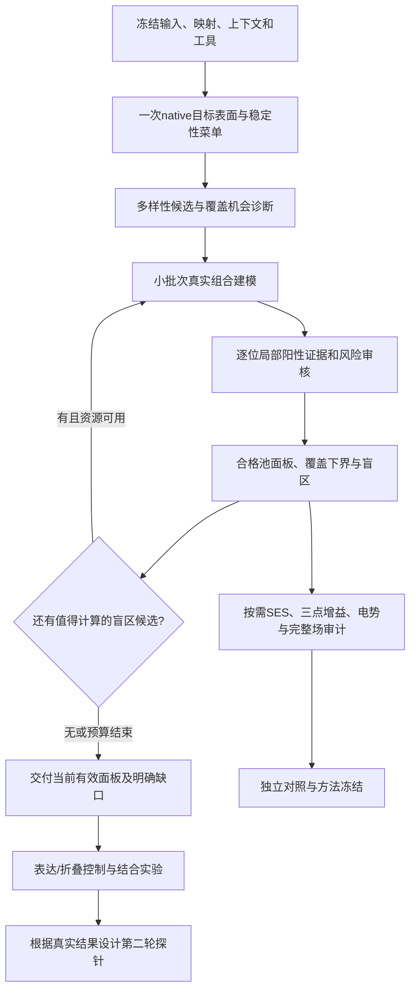

**ECD Epitope Scanner 整体流程效率与必要性审查报告**

审查日期：2026-10-03，Asia/Taipei。磁盘盘点快照：22:01；审查对象：当前工作树、历史运行数据、组合批次 `batch_20261003_155853`，重点为CTLA4最终生产交付。本次只新增报告和只读审查脚本/证据，没有修改算法、阈值、配置或账本，没有删除历史文件，没有启动新的科学生产计算。

**核心判断：当前流程存在实质性的架构和方法合同问题。增加CPU、重复次数或磁盘只能延后失败，不能解决低产出。必须把实验探针设计、阳性变化证据、完整场解析、全池搜索闭合和方法研究验收分开，重排计算顺序，并建立统一的不可变证据存储。**

以下区分三类结论：保存产物/源码直接确认的事实、可复现的最小反例、仍需对照验证的优化建议。建议不等于已实现加速，不给未经测量的“10倍提速”承诺。

**1. 本次如何核验，结论适用于什么范围**

已阅读根AGENTS、项目记忆、PD1 AF3修复审计、运行根因审计、四例/组合实现审计及既有预筛计划；重新核验关键源码与真实保存产物。18个关键源码文件的当前SHA256均与CTLA4实际启动时冻结overlay一致，因此本报告讨论的核心逻辑确实是本次运行所用逻辑。

实际做了：

- 仓库及14个相关兄弟目录的只读文件元数据盘点；统计扩展名、工具缓存和大文件。
- 保存各病例/阶段的summary、预算账本和当前交付状态。
- 读取CTLA4双层ZIP中央目录，统计成员、压缩/未压缩大小；这一步本身不声称完成CRC/全包科学核验。最终运行记录另载两层归档审计PASS。
- 对校准与生产目录间的同名数组逐文件SHA256比较，并确认不是同一个底层文件。
- 直接从保存hard矩阵重算两个组合的覆盖率；未重新求解FoldX/SES/APBS。
- 对真实校准函数做确定性未知的5→10→20模型最小反例。
- 统计候选池、逐位证据、局部资格和报告中的成对假设列表。

磁盘数值为**可读取文件的逻辑大小下界**，不是NTFS实际分配块数；跳过符号链接。8个旧测试/pytest缓存目录因WinError5无法盘点，未修改ACL。兄弟目录未逐字节核验全部权重，不能把相同文件名/大小当作已证明的可删除副本。没有新的完整科学运行，也没有用本次审查声称新的构建体合格。

证据入口：[analysis.json](<E:/user/New project/ecd_epitope_scanner/docs/workflow_efficiency_audit_20261003/analysis.json>)、[磁盘盘点](<E:/user/New project/ecd_epitope_scanner/docs/workflow_efficiency_audit_20261003/disk_inventory.json>)、[运行快照](<E:/user/New project/ecd_epitope_scanner/docs/workflow_efficiency_audit_20261003/campaign_snapshot.json>)、[归档盘点](<E:/user/New project/ecd_epitope_scanner/docs/workflow_efficiency_audit_20261003/archive_inventory.json>)。

**2. 先定义真正需要解决的问题**

目标是：用有限的可实验构建体，改变可靠ECD表面的不同局部化学特征，在控制表达/折叠混杂的前提下，为未知抗体结合区域提供覆盖和定位信息。

这需要四种彼此独立的证据。

| 需要回答的问题 | 最小必要证据 | 不要求先证明的事情 |
|---|---|---|
| 这条序列能否正确制造？ | WT字母、UniProt/auth/FoldX映射、完整组合序列、基序与保护政策 | 整个表面全部物理通道已收敛 |
| 构建体是否具有可接受的结构风险？ | 明确适用域的稳定性证据、真实组合检查、实验表达/折叠对照 | 预测评分等于实际表达率 |
| 它是否确实产生局部计算变化？ | 指明通道、单位、实际组合、多次模型一致性、对应局部误差/未知 | 每个其他通道在所有支持点都确定 |
| 面板能覆盖/区分多少目标？ | 固定完整分母、已验证支持的下界、未知上界、盲区与签名混淆 | 穷尽所有可能替换并证明全局最优 |

计算扫描机会、真实改变面积、实验结合响应和定位分辨率必须分别报告。一个12 Å扫描核触及某足迹中心，不等于该抗体会出现binding loss。保护位点仍留在目标分母；不能通过删掉困难表面制造高覆盖。

当前路线把一个应用任务前置成了多个研究任务：逐候选完整多通道解析、数值收敛、真实三点增益对照、候选池闭合、最终电势审计、历史层级兼容报告。每项各有用途，但并非每项都必须阻断首批实验探针交付。

**3. 实际产出：已经算了很多，但主要卡在证据资格转换**

最新CTLA4当前快照是**两个局部合格组合、36.3488%的hard/all计算扫描覆盖**，不是80%目标完成，也不是8个构建体。此前某个病例/阶段只有一个结果与这个快照可以同时成立；不能将不同批次相加凑数。

从保存矩阵独立复算：可靠表面分母为6874.3633 Ų；候选为 `V41_2dc2b28353f9346e` 与 `V41_41898524d8f06c86`。请求K=5、8、12时实际都只有这两个，所以三个标签对应相同覆盖。最大连通盲区约4364.3 Ų，缺口仍然很大。

| CTLA4当前保存对象 | 实测规模 | 含义与限制 |
|---|---:|---|
| `panel_candidates.json` | 264项：204双点、60三点 | 候选池不是已交付构建体 |
| 同一文件formal_eligible | 82项 | 是该候选文件的阶段资格，不等于最终物理局部资格 |
| production局部审核条目 | 83项 | 与上行不是严格嵌套漏斗；历史恢复/审核时点不同 |
| 全通道局部解析complete | 3/83 | 其余大多被完整解析合同阻断 |
| 逐位阳性贡献complete | 11/83 | 只证明该项逐位计算证据，不能代替其他资格 |
| 最终局部交付 | 2项 | 尚无80%目标面板 |
| 最终物理归档核验配对模型 | 599对 | 包括未入选候选及null扩展，不是599个构建体 |
| 当前校准账本 | 14400.28秒，关闭 | 达到/略超过4小时上限，不能凭生产余额补偿 |
| 当前生产账本 | 4024.41秒，关闭 | 同批累计，包含恢复与监督计时 |

保存的排除原因包括65项COMBINATION_REJECT、104项SPURS_ONLY_REVIEW_REQUIRED、12项MODEL_DISAGREEMENT、52项HIGHER_ORDER_REQUIRES_FOLDX；这些原因非互斥，不能相加当作被拒绝总数。未获得确认的候选不等于实际不稳定。

本批两阶段累计约5.12小时；它不能代表过去几天的总计算时间，也不能证明5.12小时全部在求解。旧审计已确认Modern Standby、关机、中断、错误工具路径、长路径崩溃、文件锁和磁盘耗尽等损耗。本报告不把这些壁钟时间全部归因于算法。

**4. 磁盘：100G级占用有具体来源，不能归因于少数最终构建体**

| 对象 | 可读取逻辑大小 | 解释 |
|---|---:|---|
| 当前整个仓库 | ≥116.05 GiB | 228683个文件，包含运行、权重、环境、工具缓存 |
| `workspace_data` | 79.21 GiB | 历史运行/缓存/导出，不是单次任务占用 |
| `.tool_cache` | 19.37 GiB | 多模型缓存与安装轮子；并非全由ECD主路线产生 |
| `models` | 9.02 GiB | 主模型权重 |
| `.tool_envs` | 5.97 GiB | 工具环境，Paraplume占大部分 |
| 当前组合批次 | 12.40 GiB | CTLA4约7.79、PDL1约4.60 GiB，其余小量元数据 |
| 三个旧validation兄弟目录 | 合计约27.40 GiB | 每个约9.13 GiB，主要是相同路径/大小的模型资产；全量内容去重尚未核验 |
| 仓库加所盘点相关兄弟目录 | ≥144.08 GiB | 文件逻辑总和，不等于本次新增或可立即释放量 |

以下按角色/扩展名统计，**与上表有重叠，不能重复相加**：

- 全仓库187个ZIP约17.37 GiB。
- `physical_cache`按角色盘点约35.73 GiB；进一步扫描其中约18.78 GiB为OFF网格、9.94 GiB为DX电势网格、4.22 GiB为`triangleAreas.txt`、2.15 GiB为查询NPZ，另有输入、日志等。
- `foldx_short`约2.79 GiB；这是长路径修复后的真实模型执行目录，应进入证据对象引用和保留策略，不能盲删。
- 仅CTLA4校准→生产之间，**856个数组SHA256完全相同、底层文件身份不同，重复258955415字节，约247 MiB**。这是直接核验过的副本冗余，尚未统计其在其他阶段/归档中的重复。

当前CTLA4两阶段有四个顶层ZIP，总计约1.64 GiB。生产物理证据ZIP约343 MiB，其中压缩后field成员约255 MiB，占约74%；外层设计ZIP又完整包含该证据ZIP。因此同一份证据同时存在原目录、内层ZIP和外层ZIP，再被attempt快照保留。**保留每次尝试的身份是必要的，反复复制同一大包不是必要的。**

NanoShaper每次缓存留下OFF、xyz/xyzr、三角面积等文本；APBS留下大DX；大部分是可重建中间格式。历史失败OFF是诊断证据，必须保留其来源和内容，但可以单份压缩冷存，不必每次失败都在热缓存中留下新的全量副本。

快照时E盘仅约11.16 GiB可用。既有监控低磁盘5 GiB只记录事件，没有基于预计输出进行容量预留；磁盘耗尽之后才发现，足以使ZIP与阶段交付一起损坏。这是资源调度缺陷。

**5. 时间：本次不能把APBS当主因，也不能把工具缓存命中当端到端加速**

| 保存阶段的活动记录 | CTLA4校准 | PDL1校准 |
|---|---:|---:|
| NanoShaper调用 | 231次，89.38秒 | 293次，157.56秒 |
| 三角SDF/投影查询 | 554次，1396.07秒 | 682次，1856.95秒 |
| 配对表面field外层记录 | 298次，2079.05秒 | 295次，2932.53秒 |
| APBS/PDB2PQR | 0/0 | 0/0 |
| 最后保存的局部校准轨迹 | 11项20次仍不完整；1项5次完整 | 12项20次全部不完整 |

field外层耗时包含部分工具和查询，**不能将三行耗时相加**。这是最后一份summary所记录的活动，不是所有旧尝试的完整profiling。

至少可以确认：在这些已记录活动中，Python三角查询远重于NanoShaper求解；机械追加null正在消耗预算；本阶段APBS没有调用，优化APBS不会解释这次校准为何耗尽。

CTLA4最后一次production记录中NanoShaper为0，173条配对field记录合计约1.74秒，说明合法field复用确实有效。但累计生产账本仍为4024秒；其余时间不能在缺乏分段日志时直接断言都来自FoldX、层级报告或缓存读取。必须新增互不重叠的span，分别记录加载、编码、FoldX、mesh读取/构建、SDF、化学、null、求解器、序列化、归档、hash及等待。

**6. 最重要的合同缺陷：阳性证明与全场完备性被绑定**

当前逻辑存在两个不同的量词：

- [classification.py:63](<E:/user/New project/ecd_epitope_scanner/surface_perturbation/classification.py:63>)以通道阳性结果的OR建立直接改变种子，并要求同四次模型的真实支撑。
- [calibration_scope.py:37](<E:/user/New project/ecd_epitope_scanner/surface_perturbation/calibration_scope.py:37>)要求所有声明标量与联合向量通道，在整个请求支持范围全部complete。
- [engine.py:478](<E:/user/New project/ecd_epitope_scanner/surface_perturbation/engine.py:478>)通常只有满足后者加测量完备性、或严格hard上界已闭合，才交付局部构建体。

当前共有23个保存分量，归并为11类标量及4类联合向量资格。只要其中一个通道的一个请求点长期未知，就可能阻断整个候选的complete。

真实数据：CTLA4有34项局部审核的“至少一个已知通道”并集覆盖达到100%，但全通道complete仍为false；PDL1对应25项。它们**不能据此直接升为合格**，因为还需要稳定性、逐位贡献、重复一致性和真实阳性证据，但已经证明“没有任何局部信息”和“所有通道尚未完整解析”不是一回事。

对于一个单调的阳性覆盖声明，在点x已经有某个合法通道证实变化，另一个通道unknown只能意味着尚可能存在更多信息，不能推翻已经证实的阳性。反之，若要声称“该点没有变化”或“全部变化区域已知”，unknown当然必须阻断。**这是两种不同的证明义务。**

建议建立新的、显式版本化合同：

1. `verified_positive_support`：每个阳性点保存具体通道、单位、阈值、同组重复和直接支撑；未知点不计入已验证覆盖。
2. `complete_field_resolution`：继续按严格全通道要求审核，供完整负结论与方法研究使用。
3. `verified_coverage_lower_bound`与`unresolved_upper_bound`：固定分母，分别计量，不以unknown填零或放大核。
4. `search_closure`：单列搜索是否闭合，不能作为已有阳性证据交付的统一总开关。

这会改变当前正式资格定义，**属于新方法合同，不是可以偷偷放松旧门槛的工程修复**。需验证假阳性/误差、通道选择规则和稳定性条件，并按新语义导出；旧结果与旧合同仍保留。尤其不能事后从多个通道挑最容易过的一个，再把经验阈值包装成统计显著性。

**7. 校准设计：增加到20次并不自动解决未知，也不等于95%统计保证**

当前[calibration.py:13](<E:/user/New project/ecd_epitope_scanner/surface_perturbation/calibration.py:13>)要求所有null block在该点有限；Q95相对前半样本稳定，并与当前数值敏感性比较，才valid。[engine.py:417](<E:/user/New project/ecd_epitope_scanner/surface_perturbation/engine.py:417>)按5→10→20模型扩展。

最小反例已直接执行真实函数：某通道有两个点，第一个恒为0，第二个恒为NaN；无论5、10或20模型，valid均为`[true,false]`，请求范围complete始终false。追加重复无法解决结构化未知。

实际未知至少需要分为：

| 原因 | 追加同协议重复的价值 | 应当采取的动作 |
|---|---|---|
| 查询未执行/支持scope缺口 | 通常低 | 补查询；已有修复应复用 |
| His质子化/方向未定义 | 没有对应新状态证据时低 | 弃权该通道，或单独做状态场景 |
| 网格不闭合/非流形 | 无理由期待单纯追加解决 | 保存失败身份；针对网格协议诊断 |
| 同协议拓扑改变 | 不会靠把unknown改0解决 | 留作对应关系未知；另通道证据分开 |
| 经验分位数暂不稳定 | 可能有价值 | 仅在预期收益和预算允许时追加 |
| 上游进程/文件异常 | 不是科学不稳定 | 限次工程恢复与隔离失败 |

新的调度不能把这六类都送入同一个“再跑10个模型”分支。当前已有20次上限defer，解决了重复调度部分问题；但**第一次把明显不可解析候选机械扩展到20次**的成本仍然存在。

还有一项方法边界：20模型只有19个相邻WT差分，且共享WT，彼此相关。即使在更理想的独立同分布假设下，19个样本的最大值达到真实95分位数的概率也只有 `1−0.95^19≈62.26%`；5模型的4个差分对应18.55%。这仅是样本量示意，不能用来估计真实相关null的置信度。当前代码本身已注明“经验计算噪声，不是false-positive control”；不应以昂贵重复赋予它原本没有的统计保证。

建议先评估重复数与决策是否变化，保存分位数/边界距离和原因；让增量计算优先解决**可能改变面板选择的数值不稳定**。采用新的通道局部正证据合同后，完整负结论和全面场收敛留在研究审计。共享不同候选的null需要先证明重排邻域/协议可交换或误差保守，不能只按蛋白名共享。

**8. 几何计算：昂贵的是当前实现方式，不是所有局部设计都必需全套SES差分**

[geometry.py:88](<E:/user/New project/ecd_epitope_scanner/surface_perturbation/geometry.py:88>)逐查询点进入Python循环，计算三角距离、候选三角集合、射线交点和歧义；mesh构造还计算拓扑、KDTree及射线坐标。[tools.py:102](<E:/user/New project/ecd_epitope_scanner/surface_perturbation/tools.py:102>)即使SES磁盘缓存命中，也会校验hash并重新read_off/构造Mesh。同一pair在场查询、拓扑比较、fine误差与scope补查询中反复用到mesh。

现有exact query缓存值得保留，但它不能解决所有重复工作：

- whole-query与point-bank保存两份距离/valid/normal结果。
- 先读完整point bank，即使整个batch缓存随后命中；读取/解压/hash不计入主求解时间的可能性需要量测。
- 部分point miss仍重算整个原batch，再整库压缩保存，这是为了原数值路径一致；准确性理由成立，但工程代价真实存在。
- mesh本身没有统一有容量限制的内存LRU，磁盘命中仍重复解析文本和建立结构。

保持旧科学结果的工程优化顺序：mesh实例LRU→预解析二进制网格→查询缓存统一索引/减少整库重写→分批向量化或编译精确距离/射线计算。每步保留闭合、非流形、edge-hit、距离并列和normal未知的现有判据；用保存真实网格与最小退化案例比较输出。不能以最近顶点近似三角距离，也不能填洞让SDF“通过”。

更大幅度的路线简化是另一类工作：在固定native表面上，用真实配对组合的原子占据与化学场建立最小局部扰动证明；将**每个突变体的完整SES形状/法向/局部面积场**作为按需通道。某些局部原子/化学定义并不需要Mut SES来计算，当前代码已经有atom occupancy分量。

但这种路线不能把原子球边界称为SES，不能继承旧SES资格，也不能忽略外部遮挡原子。仍需用同参考、同候选、同稳定性条件做消融：它的lower-bound coverage、候选排序、错误定位和实验关联是否足够支持正式使用？在回答之前只提供明确标级的设计建议。

**9. 三点的三个双点对照：回答的是额外收益，不是构建体本身能否合法制造**

当前[combo_contract.py:18](<E:/user/New project/ecd_epitope_scanner/surface_perturbation/combo_contract.py:18>)要求三点的三个精确双点子集有真实合格对照；[engine.py:499](<E:/user/New project/ecd_epitope_scanner/surface_perturbation/engine.py:499>)要求三点对每个较低阶对照的新增扫描面积至少为**全部参考面积的5%**，不是相对该双点提高5%。

若没有共享对照，每个三点的五次确认要连带三个双点，即4组×5=20对WT/Mut模型；其局部null又可能各扩展到20次。控制成本并不止一次multi模型推理。

真实三点不能用单点并集或三点SPURS外推代替，这一点必须保留。但“证明该三点比三个双点都增加≥5%总面积”是**选择效率/增益解释合同**，不是蛋白工程普遍物理定律。若已有稳定、逐位真实阳性贡献且面板有用的三点，只是没有这种对照，科学上应区分“构建体证据”和“已证明更高阶增益”。

建议默认优先双点；只有最大盲区无法由合格双点经济覆盖时，启动少量三点。三个双点对照按具体替换去重并全批共享。若未来取消三点增益作为交付硬门槛，必须新增policy，仅交付实际三点已验证性质，不宣称独立因果归属或非加和增益；当前合同不追溯改写。

SPURS提供稳定性模型证据，官方论文描述WT特征可复用于不同解码器；这支持研究encoder复用，但不证明本地三点输出已在目标ECD实验体系校准。[SPURS原论文](https://www.nature.com/articles/s41467-025-67609-4)、[官方实现](https://github.com/luo-group/SPURS)。

**10. 候选搜索：应优化每单位资源的面板增益，不应先对整个池做同等昂贵验证**

现有菜单筛选、SPURS单点矩阵、按阶beam、全局去重、double优先和blindspot扩池已经存在；不能把“再加一次预筛”称为新的提速方案。

缺少的是把**计算本身作为可调度的实验**：在某候选上追加模型，能否增加有用阳性覆盖？能否替换一个高风险探针？是否覆盖当前最大连通盲区？是否只是再次证明另一个同位置替换？

建议将计算优先级作为独立层：

`预期新增可靠面积/签名区分收益 ÷ 预计新增CPU时间、磁盘与工具成本`。

这里的预期值只是调度proxy，不能授予正式覆盖。应保留空间和化学多样性，给不确定盲区一定探索预算，避免便宜proxy永久排除真正有用候选。

在已验证池中选面板时，以固定分母hard覆盖为主目标，结构风险/最大盲区/签名区分为明确次级目标；提供K曲线和该池内求解上下界。在昂贵真实测量之前，可用严格几何机会界做早期可行性筛查，但必须证明它对未建模构象足够保守；当前“五对实际模型”的上界不能直接用于尚未生成的模型。

如果连乐观、已证明保守的候选机会并集都不到80%，应立即报告当前替换菜单/空间限制不可行，并指出必须扩哪些盲区。若只是greedy没达到80%，不能宣称8项不可能。

**11. SPURS、DiscoTope与其他worker：必要性按目标分类**

SPURS单点全景是有价值的廉价稳定性预筛，应一次计算、按真实输入/权重/代码/参数身份缓存。multi应批量请求去重组合，不能以同一位点在不同显示区域重复推理。

[spurs_gpu_worker.py:78](<E:/user/New project/ecd_epitope_scanner/integrations/workers/spurs_gpu_worker.py:78>)每次请求装载模型，multi按阶调用完整model。WT encoder是否在每次model调用内重复执行需进一步剖析vendor内部；本报告没有新的encoder分段实测，不能声称它已经占主瓶颈。适合按收益顺序研究批次合并、checkpoint内WT特征缓存，最后才考虑常驻worker。常驻GPU服务需要内存额度、独占调度、超时和重启，不应占满并行病例资源。

DiscoTope/一般表位prior可以帮助解释或排序，但广覆盖扫描未知抗体时，硬偏向预测表位热点可能缩小空间。它应保持可选软先验，不能阻断合格表面探针。ProCaliper是SASA交叉检查，应作为一致性诊断；不能重复充当Fab可达性证明。Paraplume/IgT5及实验工作台模型资产不必为本次ECD主路线再次复制或初始化。

FoldX的真实组合稳定性和配对模型保留；在正式旧合同下保留五次，不应为追求数量直接减至一次。FoldX官方解释多次BuildModel用于算法收敛检查，且不同突变有各自匹配WT参考；因此不能用一个公共WT替代所有候选matched WT，也不能把五次当独立生物学重复。[FoldX BuildModel官方说明](https://foldxsuite.crg.eu/command/BuildModel)。

**12. APBS：有明确用途，但不属于每个候选的基本筛选要求**

当前组合实现已经只在达到目标的最终集合启动APBS，这个方向正确；本批校准APBS为0，所以不要把“移走APBS”当作本次最大提速来源。

剩余问题是[combo_contract.py:56](<E:/user/New project/ecd_epitope_scanner/surface_perturbation/combo_contract.py:56>)和目标审计仍把APBS_EXECUTION_COMPLETE绑定到ACHIEVED/PASS。建议拆为“hard目标已达成”“电势审计状态”“全流程研究验收状态”。一个已经合法证明的hard lower bound，不应因另一个附加电势通道未知而消失。

APBS计算连续介质电势，依赖结构、质子化、原子电荷/半径和离散网格；它不是未知抗体亲和力计算器。官方文档明确这些输入和离散误差的影响。[APBS背景与误差说明](https://apbs.readthedocs.io/en/latest/background.html)。保留charge-changing最终候选的按需审计，以及单独的extended unknown；不能把代表项的误差界转移给所有构建体。

旧DX数据仍是重放证据，不能直接删除。未来应区分原始求解网格、采样后表面值和交付所需文件：热缓存保留必要采样与数值身份，原始DX单份压缩冷存或显式可重建保留等级；具体压缩节省需实测。

**13. 报告兼容层产生了可确认的大对象复制**

CTLA4生产`analysis.json`约82.75 MiB，`selected_panel_v4.json`约33.33 MiB，`hypothesis_hierarchy_v411.json`约33.96 MiB，`v4_manifest_v41.json`约36.42 MiB，离线HTML约43.26 MiB。

其中同一个hierarchy_resolution在selected_panel与hierarchy报告中经对象比较确认完全相等，紧凑JSON也有18850558字节，约17.98 MiB；manifest又携带同一类大列表。raw层508个hypothesis产生128778个pair，其中127391个near pair；family层127个hypothesis另有8001个pair、7959个near pair。

这些O(H²)成对距离对定位诊断有用，但对“先交付面板并证明面积覆盖”不是必备中间交付。它们还基于proxy hypothesis response，不能用计算规模大来替代实验定位真值。

建议：把完整pair诊断只保存一次，用对象ID引用；主JSON只保留最小距离、分位数、混淆组/最大连通歧义区域及必要签名；需要逐pair审计时打开单独压缩列式文件。不要按相同签名直接丢弃真实不同位置，需要保留位置索引及回映关系。

[models.py:249](<E:/user/New project/ecd_epitope_scanner/models.py:249>)和reporting的asdict会深复制dataclass，再递归序列化。规范化实体、array文件与只读引用比重复嵌套对象更合适。本次确认了对象重复与体积，未量得序列化的独立CPU时间，故不将它断言为主要耗时百分比。

**14. 恢复与失败语义：已有结果不应因后续研究步骤超时一并消失**

当前[engine.py:661](<E:/user/New project/ecd_epitope_scanner/surface_perturbation/engine.py:661>)在捕获某些TimeoutError/RuntimeError/ValueError时统一设置INCOMPLETE并清空final；finally又可清空verified_local_constructs。此前合法hard checkpoint另有保留，说明系统已有避免完全丢失的基础，但当前交付与checkpoint可能出现不同状态。

必须区分：

- 全局reference/映射/hash不合法：确实应使依赖证据全部失效。
- 某候选不合法：只撤销该候选及依赖它的结果。
- 扩池任务超时、预算耗尽、某个可选通道未知：终止新增计算，保留最后已完整审计且仍有效的局部交付，任务状态继续INCOMPLETE。

不能把旧attempt的结果当作新attempt当前成功；正确方案是显式引用不可变最后有效checkpoint、来源attempt和使用合同。

恢复不应重新执行整条pipeline再构造全部报告。当前benchmark每次调用run_pipeline，虽然上游模型有缓存，仍会进行阶段组织和导出；尝试快照还复制两层大ZIP。应建设阶段DAG：每节点有输入身份、状态、产物、引用、计时与预算；恢复只继续缺失节点。启动前检查二进制、路径长度、输入映射、冻结代码、磁盘预留和缓存一致性。

历史待机/关机已经说明预算账本不能兼任性能profile。旧账本不退款；未来合同分别保存用户等待壁钟、实际活动时间、求解器CPU/GPU时间、I/O和中断原因，再明确哪个计入预算。

**15. 必须保留、按需执行、应重构的完整清单**

| 环节 | 判断 | 推荐调整 |
|---|---|---|
| 输入/结构类型/AF3 confidence/来源hash | 必须 | 统一输入合同，启动前核验 |
| auth/UniProt/FoldX编号与WT字母 | 必须 | 一次建立不可变映射，各输出复用 |
| 糖基化/二硫键/组合基序与结构风险 | 必须 | 在组合全序列再次检查，未知上下文单列 |
| native可靠目标表面和完整分母 | 必须 | 同输入/上下文/方法一次建立，SAS/SES命名分开 |
| 显示连通/直径约束 | 必须保留 | 作为显示层；不限制跨显示边界的科学组合 |
| 单点替换菜单与稳定性预筛 | 必须有 | 复用现有矩阵，避免重复扫描 |
| SPURS multi/真实组合风险确认 | 有价值 | 小批次去重，关注适用域和模型分歧 |
| FoldX匹配WT/Mut与正式重复 | 现合同必须 | 增量复用；不同候选matched WT不得共用 |
| 每个位点同组真实阳性贡献 | 必须保留 | 证据指向通道/模型，不能靠单点并集合成 |
| 所有通道、所有支持点complete | 完整场研究需要；正证据交付未必需要 | 新合同分离；旧资格不改判 |
| 对确定性未知追加到20次 | 设计缺陷 | 原因分类和预期决策收益驱动 |
| 逐Mut完整SES/SDF/法向/面积 | 对这些通道的声明必须；最小探针设计按需 | 新最小路线消融，保留通道unknown |
| 三点全部真实双点对照与5%增益 | 增益声明需要；基础构建体资格不是普遍必需 | 双点优先；三点研究policy另列 |
| hard覆盖矩阵、K曲线、盲区 | 必须 | 在合格池优化；上下界限于对应候选域 |
| 穷尽全池解析/搜索闭合 | 证明池内完备性需要 | 不阻断已证实的可行面板；不得声称全局最优 |
| APBS与extended解析 | 电势声明需要 | 最终候选按需；与hard达标分开 |
| 独立路线对照/holdout/消融 | 方法冻结与新默认需要 | 作为独立研究，不在每次生产重跑 |
| 原始证据、hash、失败来源 | 必须 | 单份内容对象、引用和失败标记 |
| 多层ZIP、全量attempt复制 | 设计缺陷 | 一个正式导出包，过程checkpoint引用 |
| 大型O(H²)兼容报告 | 定位专项按需 | 单份诊断、摘要与懒加载 |
| 全局资源预算与容量预留 | 必须 | 时间、内存、磁盘、工具线程共同调度 |
| 实验表达/折叠/结合对照 | 最终解释必须 | 不能被增加计算层替代 |

**16. 推荐重构路线：将计算量集中到真正能改变实验决定的环节**

E阶段的新正证据语义需要独立验证；在验证完成前，保留当前正式路线，同时用新路线shadow评价。不能用图中的阶段重排把未确认候选标成正式合格。

单轮运行的最小交付应包含：组合和编号、ECD/完整序列、必要模型与DDG、逐位阳性通道证据、覆盖分母/下界/未知/盲区、实际构建体数、状态和manifest。研究资料另有可追溯入口；最终只生成一份可携带完整依赖的包。

若最终只有两项，交付两项及不可达原因，而不是等待全部研究收敛后才让用户看到结果。若12项仍不足80%，必须明确是哪一类缺口：可变位点不足、菜单不足、未建模、真实风险拒绝、未知物理证据、还是求解器未找到可行面板。

**17. 实施优先级与具体验收，不再以“跑完很多测试”替代效率改善**

| 优先级 | 工作包 | 触及代码 | 必须验收的结果 |
|---|---|---|---|
| P0 | 互不重叠profile与资源预留 | runtime/tools/worker/协调器 | 完整调用数、CPU/GPU、I/O、等待与峰值；存储不足先暂停新增节点，当前checkpoint完整 |
| P0 | 不可变对象索引与单份引用 | field/null/worker/cache/export | 同字节对象不重复存储；源hash不变；失败mask随引用；损坏对象拒绝；portable导出可重放 |
| P0 | 最后有效结果与失败隔离 | engine/local_constructs/case_status | 扩池超时保留已验证产物；全局身份错误仍撤销依赖；新旧attempt不混用 |
| P0 | 过程轻导出、最终单包 | export/reporting/benchmark | 中间阶段不反复写全量双ZIP；最终成员/序列/hash一致；旧包保留 |
| P1 | mesh LRU/二进制预解析/精确查询加速 | tools/geometry/query_cache | 固定真实mesh/query下valid与unknown一致，距离/法向容差预注册，分类不漂移 |
| P1 | 原因分类与收益调度 | calibration_jobs/schedule/engine | 确定性未知不机械扩展；相同失败身份有负缓存；数值边界问题仍可追加 |
| P1 | 阶段DAG与差额恢复 | pipeline/benchmark/coordinator | 杀进程/锁/磁盘中断重放只重算缺失节点，不触及他人进程，不重置账本 |
| P1 | 报告规范化与pair诊断单存 | models/reporting/identifiability | 摘要、最小距离和混淆组保持一致；完整pair可单独审计；UI加载合理 |
| P2 | 阳性证据/全场解析合同分离 | classification/calibration_scope/combo/engine | shadow独立对照；unknown仍unknown；逐位/稳定性/重复要求不偷偷放松；新版本声明准确 |
| P2 | 最小原子/化学路线与SES消融 | fields/reference/calibration | 同候选同分母公平比较；失败/假阳性/排序稳定性及holdout证据 |
| P2 | 双点优先与三点policy分级 | candidate_search/combo_contract | 实际组合仍建模；省略对照时不声明增益；盲区收益与工具成本实测 |
| P3 | encoder缓存/常驻模型worker | spurs worker/vendor adapter | 输出同合同、模型身份正确、并发/内存限流和OOM恢复；测得端到端收益才启用 |

P0/P1主要是保持当前科学语义的工程优化；P2包含新科学合同，必须独立冻结和验证。修复应分小范围patch，保留用户工作树改动，不能全仓库自动格式化或全量stage。

资源目标建议作为待测SLO而非承诺：共享权重/环境不计入每个病例增量；原始证据单份；每个阶段在一批高价值候选后就产生可审查checkpoint；从已保存相同输入恢复时新增FoldX/SES调用应等于真实证据缺额。容量上限先由当前保留证据与峰值估计制定，不能凭空保证单病例≤某个GB或几分钟出8项。

**18. 验证设计：既要快，也要证明没有制造成功**

工程优化先用现有保存输入，无须再跑四例几天：

1. CTLA4/PD1/PDL1/B7-H6各取一个有代表性的合法配对、一个真实unknown/mesh失败及关键退化案例；保留AF3类型与confidence。
2. 冻结相同query与候选；对新旧mesh缓存、精确查询、存储引用、轻导出做等价性和资源比较。
3. 对timeout、文件锁、容量不足和损坏对象做最小生命周期测试，证明没有后代残留、没有半包宣称成功、没有删除历史证据。
4. 工程等价通过后，做一例有界端到端比较，记录不重叠成本；新改动/失败才增加测试范围。

P2方法变更另做冻结对照：同输入、同候选池、同K、同稳定性资格、同native分母；比较当前全通道路线、正证据lower-bound合同和最小局部路线。再分别衡量独立候选搜索路线，不能将物理方法已选中的小面板当作所有基线的共同可选池。

验收指标同时包含：实际合格构建体数、不同位点/不同区域数、hard下界、未知上界、最大连通盲区、签名混淆、确认/校准拒绝原因、工具调用、CPU/GPU时间、峰值内存/磁盘、最终包大小。相同位置的多个替换不能算作多个区域。

有复合物接触标签时按蛋白/域/抗体家族做holdout；接触几何仍不等于binding-loss实验真值。模型预测与FoldX一致不构成独立实验验收。方法冻结最终需要表达/折叠控制及真实结合观测。

已证实的工程收益候选只有“856个相同数组的247 MiB副本可通过统一引用避免再产生”和可确认的大对象/归档重复；它们尚未实施。其他加速倍数、压缩比例、新增合格数量、80%可行性仍需上述比较，报告不预填成功值。

**19. 建议作出的架构决定**

不再把“所有研究证据齐全”当作每个应用结果的单一完成标签。采用：可制造设计 → 真实组合风险通过 → 局部阳性变化证明 → 面板覆盖下界 → 全场解析/搜索闭合 → 电势和方法研究验收，各自独立状态、证据和成本。

优先停止产生新的数据副本和低收益机械重复，建立阶段恢复与精确几何加速；随后用独立方法版本验证正证据交付与最小局部路线。对现有失败保持真实解释，而不靠改阈值、减分母、取消映射/稳定性或扩大扫描核来增加数字。

当前系统的低效率，不是“科学必须这样昂贵”已经获得证明。它来自**应用目标与研究验收过度耦合、未知原因未分类、几何实现开销、缓存/归档多份存储和失败恢复粒度过大**。这些问题具备明确可修改位置和可测验收标准；继续沿旧流程追加完整四例和20次null，不应作为默认解决方案。
